# Musical Display of Power (MDoP)

**English** · 🇧🇷 **[Leia em português](README.pt-BR.md)**

**A self-hosted library for your own music.** MDoP gathers the recordings scattered across your phone and computer (voice memos, takes, MIDI files, Guitar Pro tabs, lyrics, covers). Riffs and sketches become **ideas** you can work on, finished pieces become **songs**, and songs are grouped into **albums** and **bands**. Each song keeps all of its versions, so nothing gets overwritten.

It runs on your home server with Docker and opens in any browser on your network, on a computer or on a phone.

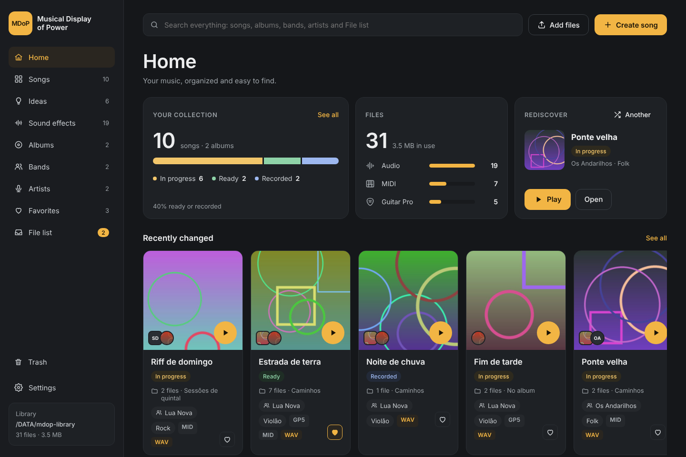

## Features

- **File list (inbox).** Drop whole folders in. Files land here loose, without becoming songs yet. Listen one by one (↑ ↓ plays the next) and decide: **send to Ideas**, **create a song**, **add to a song** (optionally as a new version) or **discard**. Search, filter by type and by source folder, mark the good ones, and remove byte-identical duplicates.
- **Ideas.** A workshop for riffs, melodies, harmonies, scales and exercises that aren't songs yet. Each idea keeps its audio, tabs and MIDI, a type (create your own types too), key, tuning, tempo and notes. Filter by type and key, study it in the Listening room, then **turn it into a song** (it keeps every file, note and marker, and remembers when it started as an idea) or **add it to an existing song** as a new version.
- **Sound effects (SFX).** Link the folders of your effects library, even tens of gigabytes: MDoP only reads them (nothing is copied or changed). Subfolders become categories; search, filter by duration, format and tag, mark favorites, and audition effect after effect with ↑ ↓. Rescanning only reads what changed, and a disconnected drive shows its effects as unavailable instead of losing them.
- **A song is a folder.** Files are sorted by type (audio, scores and MIDI, images, other), every version is kept, and a star marks the main file. A **Texts** tab holds structure, ideas and lyrics.
- **Listening room.** Study a recording: zoomable waveform with a minimap, A–B loop (or just drag on the waveform), speed from 25% to 150% **without changing pitch**, saved markers and loops per file, keyboard shortcuts, and the song's key, tempo, tuning, notes, texts and credits underneath.
- **Tab viewer.** Opens Guitar Pro 3 to 8 (`.gp3` `.gp4` `.gp5` `.gpx` `.gp`) and MusicXML, draws notation and tablature, and plays it back: speed, metronome, count-in, loop a passage, solo and mute per track, zoom, page or horizontal layout, volume and full screen.
- **MIDI player.** Plays `.mid` files right in the browser with a piano roll, tracks with instrument names, solo and mute, speed, loop, zoom, volume and full screen.
- **Covers that never look empty.** Songs without an image show two eighth notes, and small circles on each card take you to the song's album and band.
- **Albums, bands and artists.** Covers, automatic cover mosaics, track order, album details (release, recording place, label, status), and credits with roles for songs, albums and band members. Every artist gets a page with everything they took part in.
- **Find things fast.** A global search on the home page, filters everywhere, **group songs by style**, status or band, and three view modes (large cards, thumbnails, list) that load gradually for big libraries.
- **Status:** songs go in progress → ready → recorded (ideas live in their own tab); albums go idea → in progress → ready → recorded.
- **ZIP download** of a whole song or album, with every version, the cover and the texts.
- **Backup and restore.** One click saves a `.zip` with the database and every folder to a backup folder (ideally another drive), or downloads it. Restoring always keeps a safety copy of the current library first.
- **Your menu, your way.** Turn off the parts you don't use (Ideas, Sound effects, Albums, Bands, Artists, Favorites); nothing is deleted.
- **Trash with restore.** Nothing is ever deleted right away, and you can put things back where they were. Optionally, empty it automatically after 30 or 90 days.
- **Optional password** (with a pause after repeated wrong attempts), English or Portuguese interface (it follows your browser by default), **dark, light and Glass** themes, and five accent colors.
- **Works offline.** Every library it uses is bundled; nothing is loaded from the internet.

| File list | Ideas | Song |
|---|---|---|
| 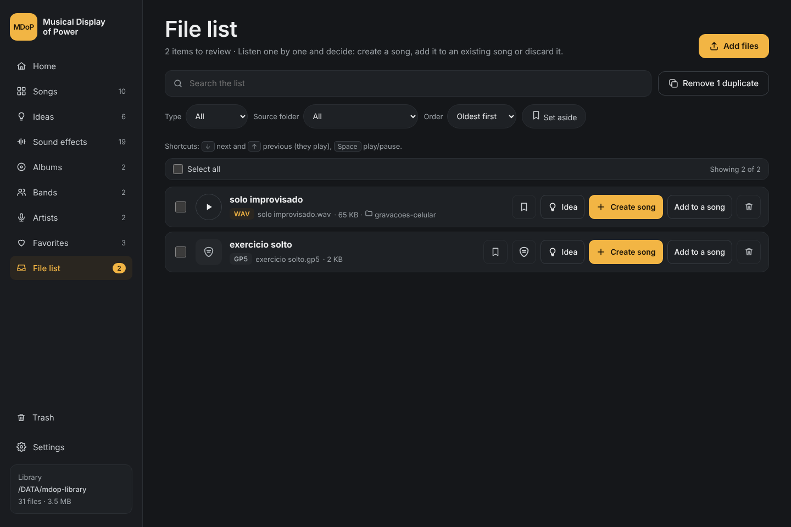 | 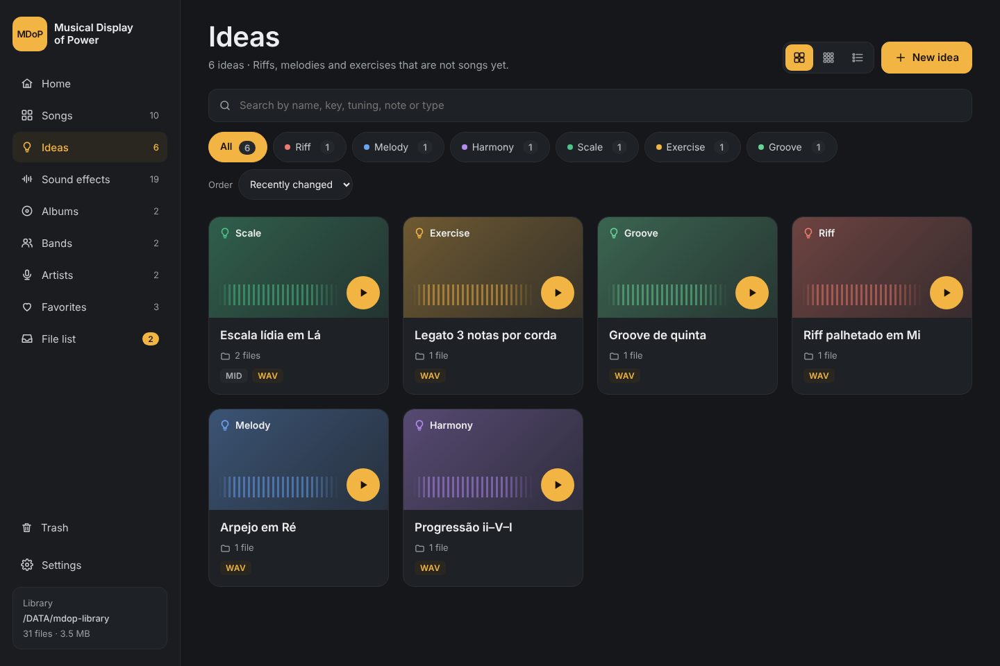 | 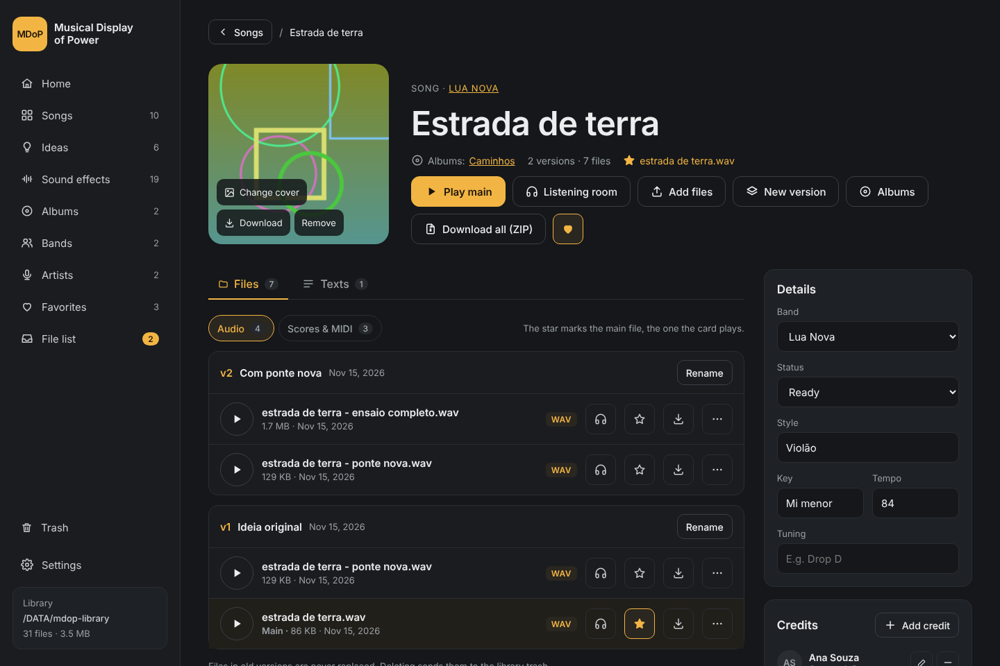 |

| Listening room | Sound effects | Album |
|---|---|---|
| 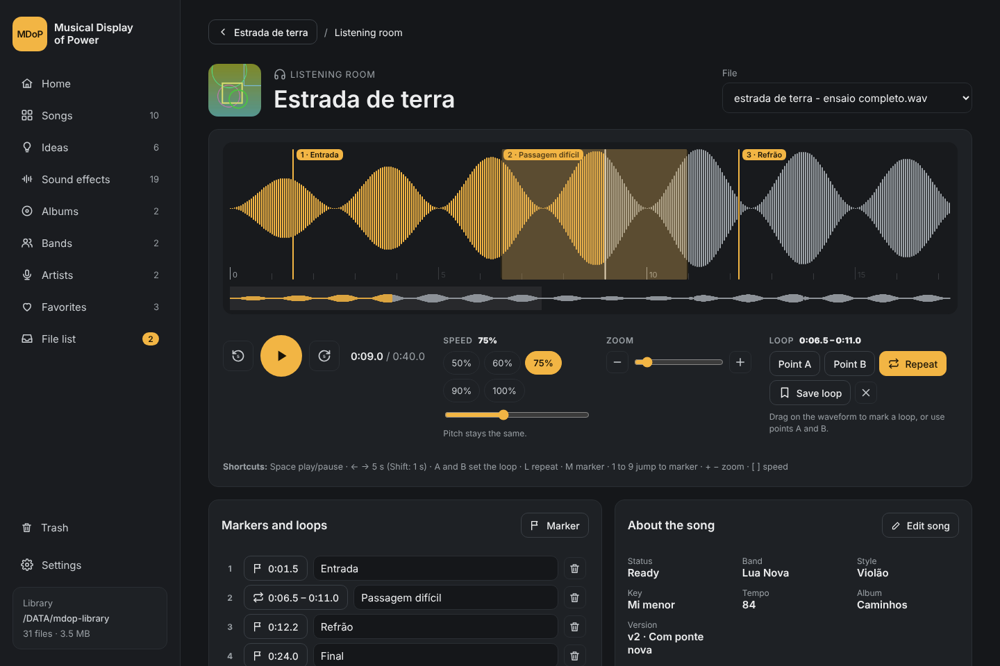 | 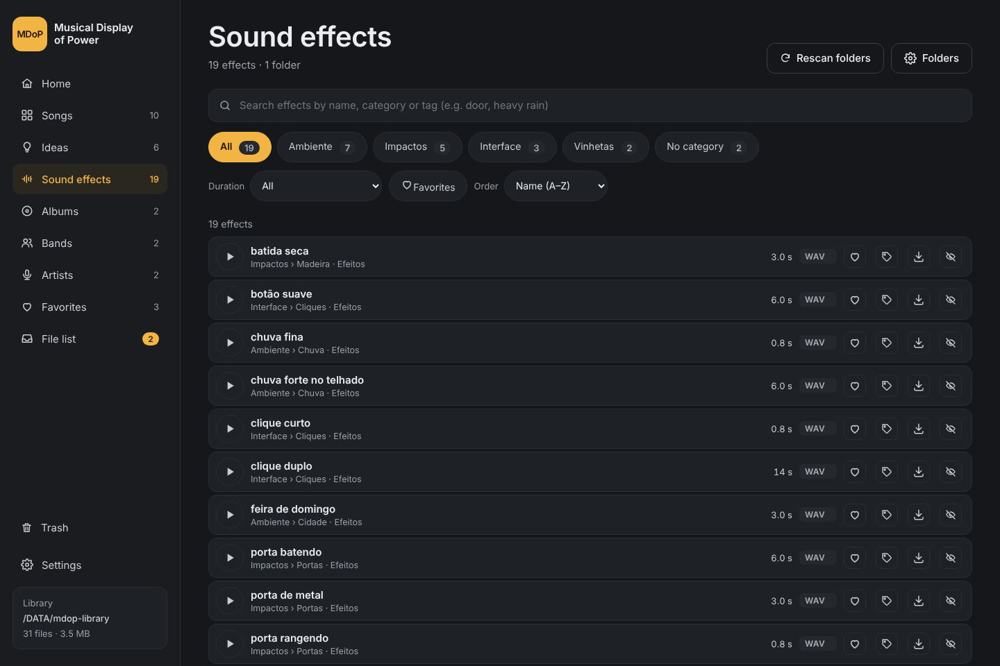 | 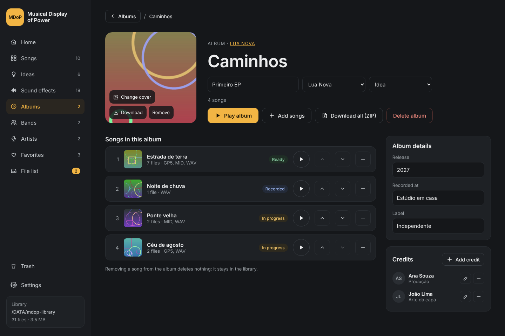 |

| Tab viewer | MIDI player | Songs grouped by style |
|---|---|---|
| 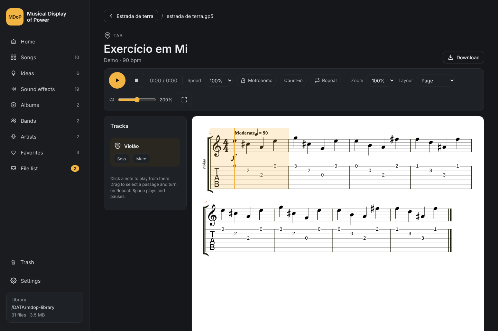 | 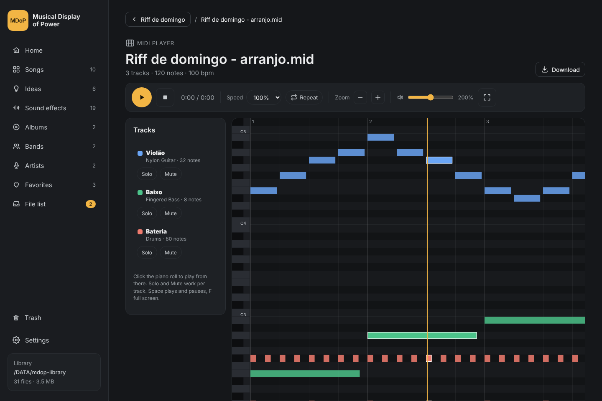 | 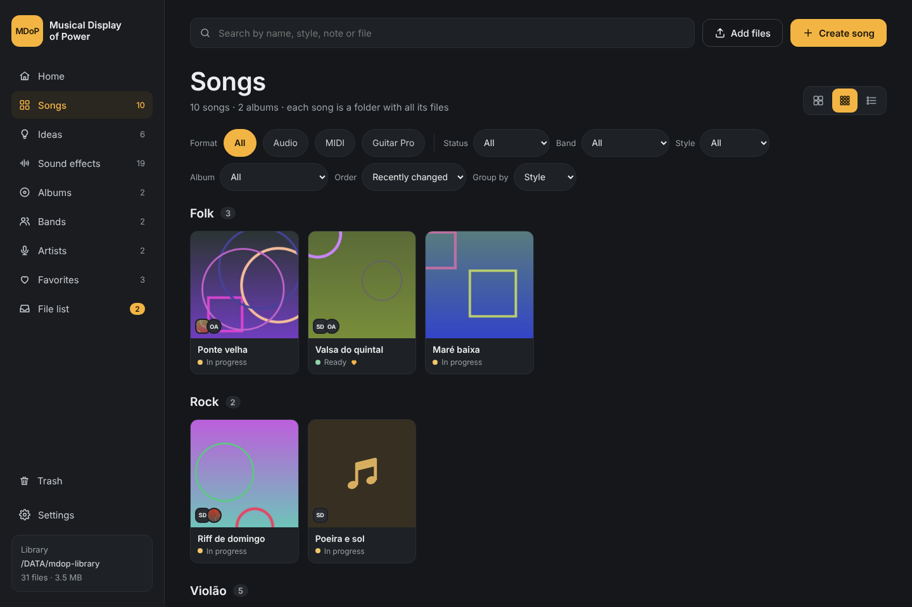 |

| Artist | Light theme | Glass theme |
|---|---|---|
| 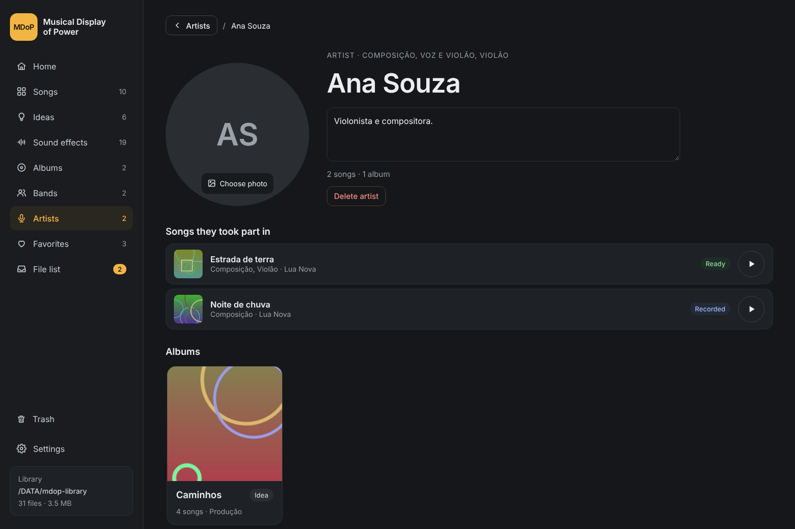 | 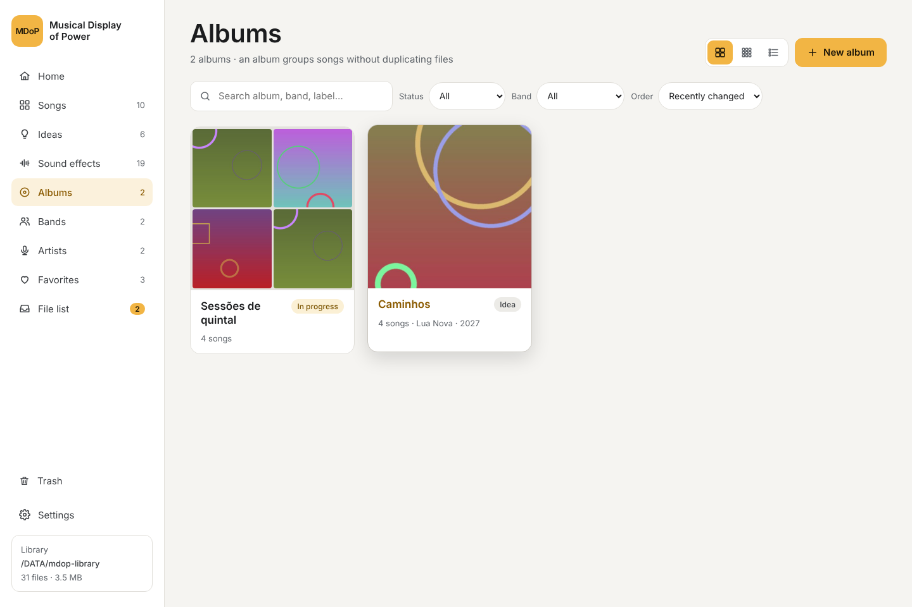 | 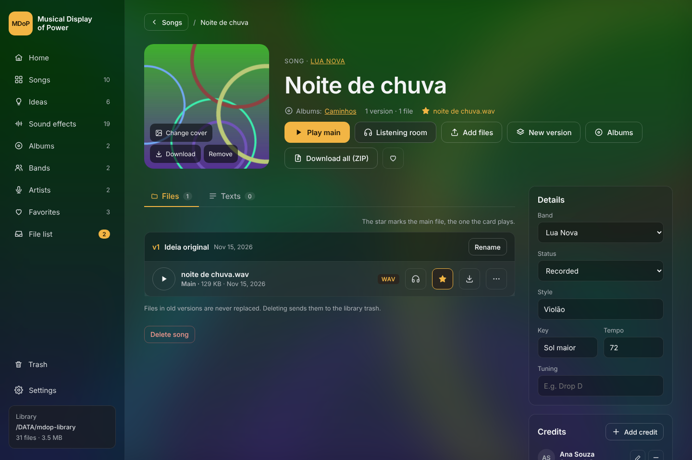 |

## Quick start (Docker)

You need a Linux server with Docker and Docker Compose (CasaOS, for example, ships with both). A ready-made image is published for **amd64** (most PCs and servers) and **arm64** (Raspberry Pi 4/5 and similar).

```bash
git clone https://github.com/carvalhopecanha/musical-display-of-power.git
cd musical-display-of-power
./install.sh
```

The installer speaks English or Portuguese (it follows your system language), asks five questions and does the rest: it creates the folders with the right owner, writes the `.env` file, downloads the image and starts the container.

1. **Library folder:** where MDoP keeps your organized music.
2. **Import folder:** the folder with your existing files, browsable under *Add files → From the server*.
3. **Sound effects folder** (optional): the root of your SFX library, made available read-only.
4. **Backup folder:** where backups are saved (ideally another drive).
5. **Port:** it warns you if the port is already taken.

At the end it prints the address to open in your browser, such as `http://192.168.1.10:8090`. The container restarts by itself after a reboot.

> Prefer to do it by hand? Copy `.env.example` to `.env`, edit the paths, and run `docker compose up -d`. To build the image yourself instead of downloading it, use `./install.sh --build` or `docker compose up -d --build`.

**Read the [user guide](docs/guide.md)** for a full tour, from the first import to backups.

### Update

```bash
git pull
./install.sh       # answer "n" to keep your settings
```

The database upgrades itself, and an update never changes your music files.

### Move the library to another disk

```bash
./install.sh move
```

It copies everything to the new folder, checks that the file count and size match, and only then switches. The old folder stays until you delete it.

### Forgot your password

```bash
sudo docker exec mdop python -m app disable-password
```

## Running without Docker

Requires Python 3.11 or newer.

```bash
python3 -m venv .venv
source .venv/bin/activate            # Windows: .venv\Scripts\activate
pip install -r requirements.txt
MDOP_LIBRARY=~/mdop-library MDOP_IMPORT_ROOTS=~/Music python -m app
```

| Variable | Purpose | Default |
|---|---|---|
| `MDOP_LIBRARY` | Library folder | `./library` |
| `MDOP_IMPORT_ROOTS` | Folders browsable under "From the server" (separate several with `:`) | none |
| `MDOP_PORT` | Port | `8090` |
| `MDOP_HOST` | Listen address | `0.0.0.0` |
| `MDOP_SFX_ROOTS` | Root folders of your sound effects, read-only (separate with `:`) | none |
| `MDOP_BACKUP_DIR` | Where backups are saved | `mdop-backups` next to the library |
| `MDOP_MAX_UPLOAD_MB` | Largest file accepted per upload from the browser (`0` = no limit) | `2048` |

## Your files stay readable

The library is plain folders, so you can open it without MDoP:

```
mdop-library/
├── inbox/              files waiting in the File list
├── ideas/              ideas (same layout as a song)
├── songs/
│   └── sunday-riff/
│       ├── cover.jpg
│       ├── v1/         sunday riff.m4a, sunday riff.mid
│       └── v2/         new bridge.mp3
├── albums/  bands/  artists/
├── .trash/             trash (restorable from the Trash page)
└── .mdop/mdop.db       SQLite database
```

**Backup:** use *Settings → Backup*, or copy the whole library folder. See the [user guide](docs/guide.md#15-backup-updates-and-moving-the-library).

## Security

MDoP is meant for your **home network**. Even with a password, the local connection is plain `http`. After 5 wrong passwords, a device has to wait 5 minutes. Sound effects folders are mounted read-only. Don't open the port on your router; for remote access, use a VPN such as [Tailscale](https://tailscale.com) or WireGuard.

## Roadmap

- Desktop version for Windows, macOS and Linux, with an installer and "open with the default program".
- Generate MIDI from audio inside the app ([Basic Pitch](https://github.com/spotify/basic-pitch)).
- Tab editor.

See the [changelog](CHANGELOG.md).

## Development

```bash
pip install -r requirements.txt -r requirements-dev.txt
python -m pytest
```

The backend is FastAPI and SQLite (`app/`). The interface is plain HTML, CSS and JavaScript with no build step (`app/static/`). See [CONTRIBUTING.md](CONTRIBUTING.md).

## Third-party software

Bundled in `app/static/vendor/` so everything works offline:

- [wavesurfer.js](https://wavesurfer.xyz) 7: BSD-3-Clause
- [alphaTab](https://alphatab.net) 1.9: MPL-2.0
- Bravura music font (SMuFL): SIL Open Font License
- Sonivox sound bank: Apache-2.0

Each license is included next to its files.

## License

[MIT](LICENSE)
