# Musical Display of Power (MDoP)

🇺🇸 **[Read in English](README.md)** · **Português**

**Uma biblioteca para as suas próprias músicas, no seu servidor.** O MDoP junta as gravações espalhadas pelo celular e pelo computador (áudios, takes, MIDIs, tablaturas do Guitar Pro, letras, capas). Riffs e rascunhos viram **ideias** para você trabalhar, o que já tem forma vira **música**, e as músicas se agrupam em **álbuns** e **bandas**. Cada música guarda todas as suas versões, então nada é substituído.

Roda no seu servidor de casa com Docker e abre em qualquer navegador da rede, no computador ou no celular.

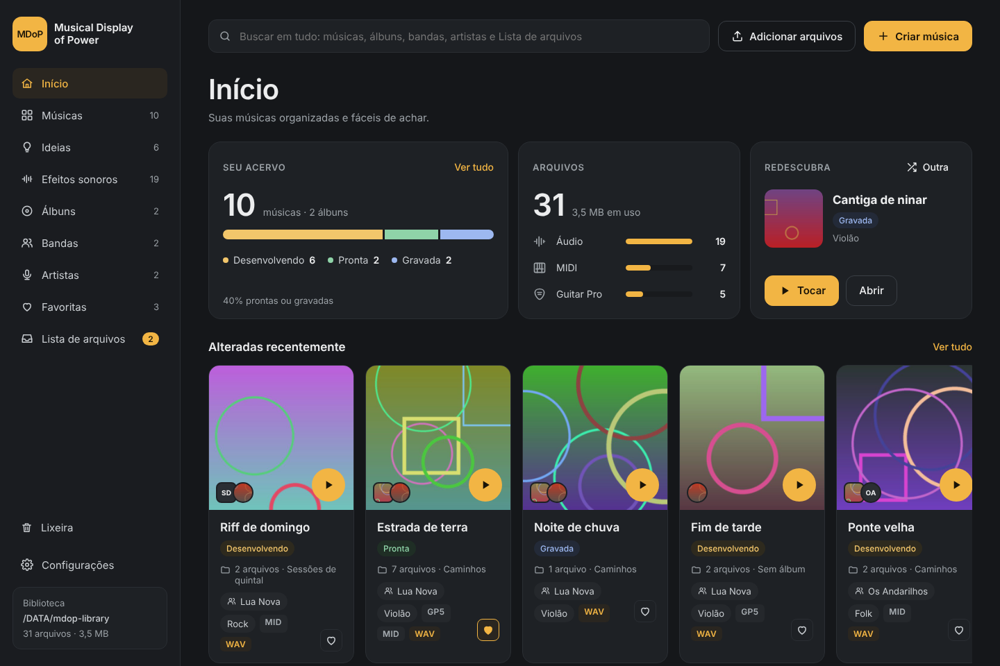

## O que ele faz

- **Lista de arquivos (caixa de entrada).** Mande pastas inteiras. Os arquivos entram soltos, sem virar música ainda. Ouça um por um (↑ ↓ toca o próximo) e decida: **enviar para Ideias**, **criar música**, **juntar a uma música** (como nova versão, se quiser) ou **descartar**. Tem busca, filtro por tipo e por pasta de origem, marcação dos que prestam e remoção de duplicados idênticos.
- **Ideias.** Uma oficina para riffs, melodias, harmonias, escalas e exercícios que ainda não são músicas. Cada ideia guarda os áudios, tablaturas e MIDIs, um tipo (dá para criar os seus), tom, afinação, andamento e anotações. Filtre por tipo e tom, estude na Sala de audição e depois **transforme em música** (ela leva todos os arquivos, anotações e marcadores, e lembra quando nasceu como ideia) ou **junte a uma música** que já existe, como versão nova.
- **Efeitos sonoros (SFX).** Vincule as pastas da sua biblioteca de efeitos, mesmo com dezenas de gigabytes: o MDoP só lê (nada é copiado ou alterado). As subpastas viram categorias; busque, filtre por duração, formato e etiqueta, marque favoritos e ouça um efeito atrás do outro com ↑ ↓. Reler as pastas só olha o que mudou, e um HD desconectado deixa os efeitos dele como indisponíveis em vez de perdê-los.
- **Música é uma pasta.** Os arquivos ficam separados por tipo (áudios, partituras e MIDI, imagens, outros), toda versão é mantida e uma estrela marca o arquivo principal. A aba **Textos** guarda estrutura, ideias e letra.
- **Sala de audição.** Para estudar uma gravação: forma de onda com zoom e minimapa, loop A–B (ou arraste na onda), velocidade de 25% a 150% **sem mudar a afinação**, marcadores e trechos salvos por arquivo, atalhos de teclado e, embaixo, tom, andamento, afinação, anotações, textos e créditos.
- **Visualizador de tablatura.** Abre Guitar Pro 3 a 8 (`.gp3` `.gp4` `.gp5` `.gpx` `.gp`) e MusicXML, desenha partitura e tablatura e toca: velocidade, metrônomo, contagem, repetir um trecho, solo e mudo por faixa, zoom, layout de página ou horizontal, volume e tela cheia.
- **Player de MIDI.** Toca arquivos `.mid` direto no navegador, com piano roll, faixas com o nome do instrumento, solo e mudo, velocidade, repetição, zoom, volume e tela cheia.
- **Capas que nunca ficam vazias.** Música sem imagem mostra duas colcheias, e pequenos círculos em cada card levam ao álbum e à banda da música.
- **Álbuns, bandas e artistas.** Capas, mosaico automático, ordem das faixas, ficha técnica do álbum (lançamento, local de gravação, gravadora, status) e créditos com a função de cada pessoa nas músicas, nos álbuns e nas bandas. Cada artista tem uma página com tudo de que participou.
- **Achar rápido.** Busca geral no Início, filtros em todas as telas, **músicas agrupadas por estilo**, status ou banda, e três modos de exibição (cards grandes, miniaturas, lista) que carregam aos poucos em bibliotecas grandes.
- **Status:** músicas vão de desenvolvendo → pronta → gravada (as ideias têm a aba delas); álbuns vão de ideia → em desenvolvimento → pronto → gravado.
- **Baixar em ZIP** uma música ou um álbum inteiro, com todas as versões, a capa e os textos.
- **Backup e restauração.** Um clique salva um `.zip` com o banco de dados e todas as pastas numa pasta de backups (de preferência outro HD), ou baixa no computador. Restaurar sempre guarda antes uma cópia de segurança da biblioteca atual.
- **Menu do seu jeito.** Desligue as partes que você não usa (Ideias, Efeitos sonoros, Álbuns, Bandas, Artistas, Favoritas); nada é apagado.
- **Lixeira com restauração.** Nada é apagado na hora, e dá para devolver tudo ao lugar de onde saiu. Se quiser, ela se esvazia sozinha depois de 30 ou 90 dias.
- **Senha opcional** (com pausa depois de várias tentativas erradas), interface em português ou inglês (segue o navegador por padrão), temas **escuro, claro e Vidro**, e cinco cores de destaque.
- **Funciona sem internet.** Todas as bibliotecas que ele usa vêm junto; nada é baixado da internet.

| Lista de arquivos | Ideias | Música |
|---|---|---|
| 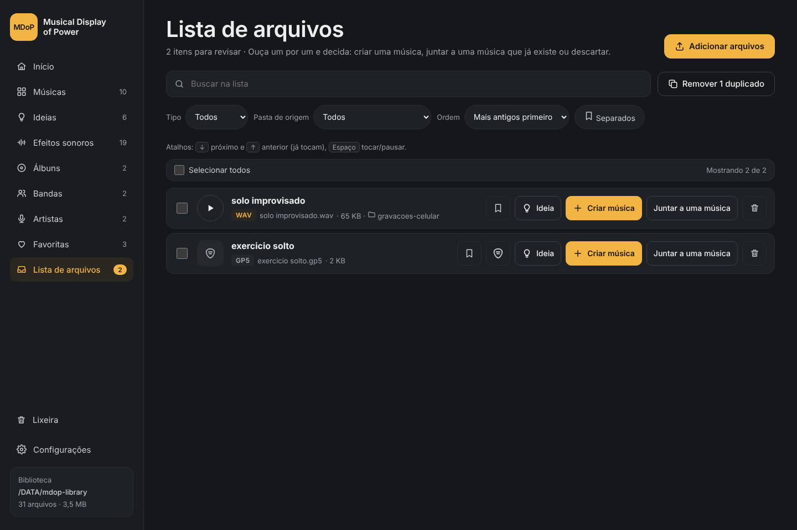 | 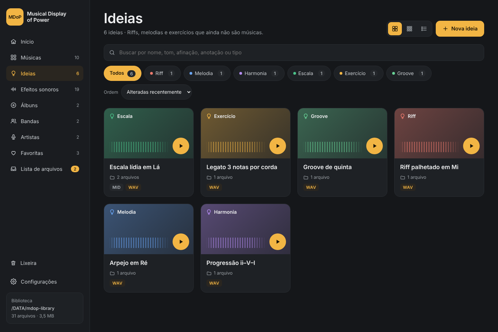 | 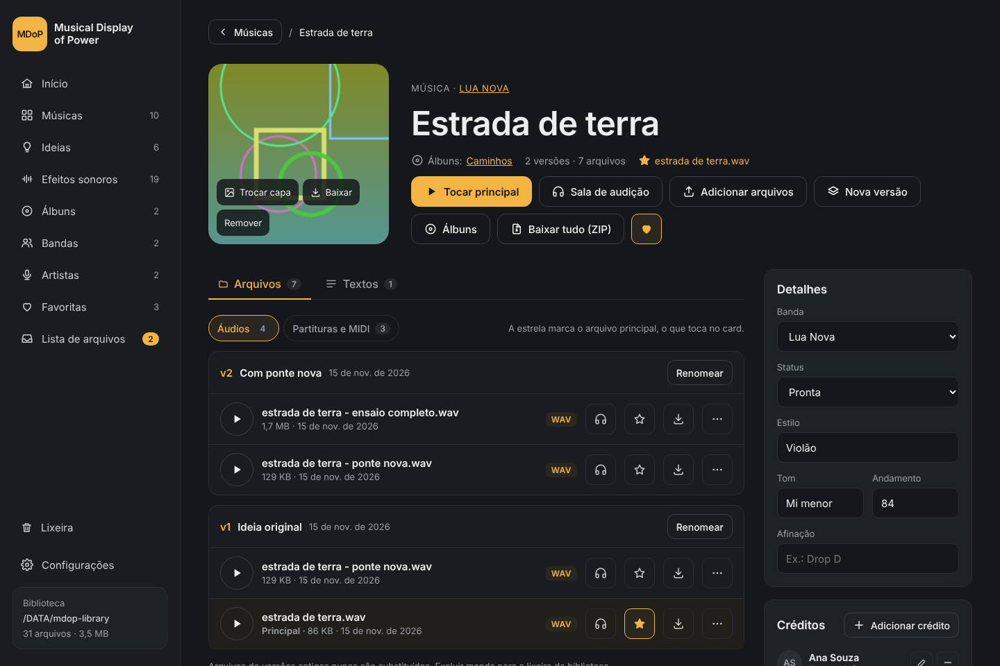 |

| Sala de audição | Efeitos sonoros | Álbum |
|---|---|---|
| 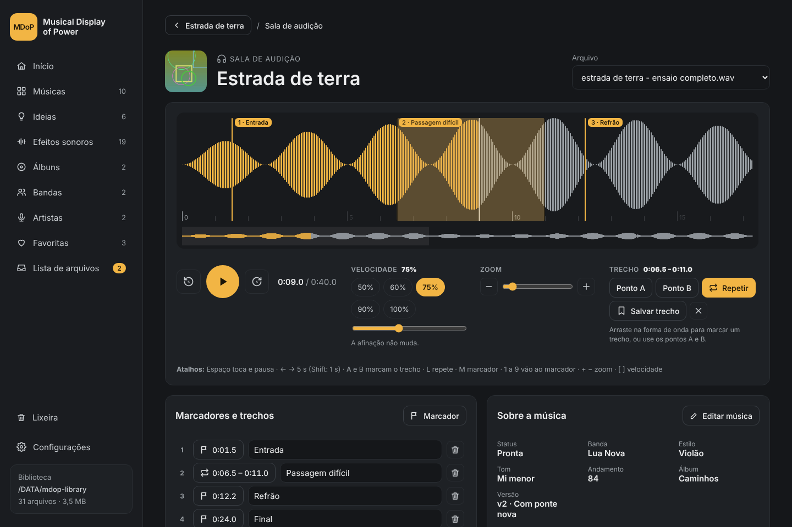 | 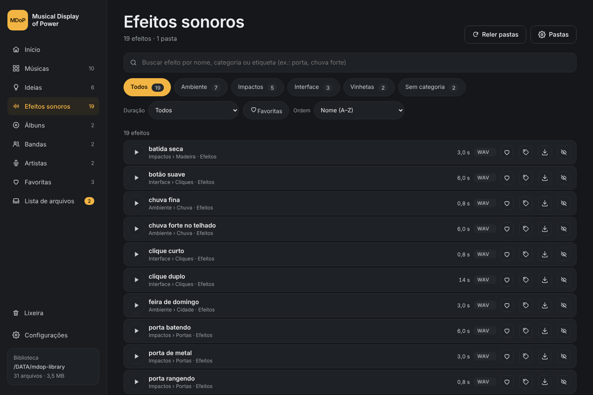 | 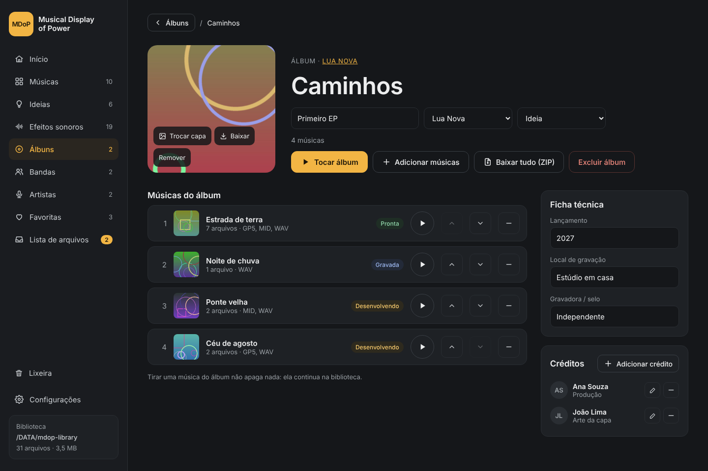 |

| Tablatura | Player de MIDI | Músicas agrupadas por estilo |
|---|---|---|
| 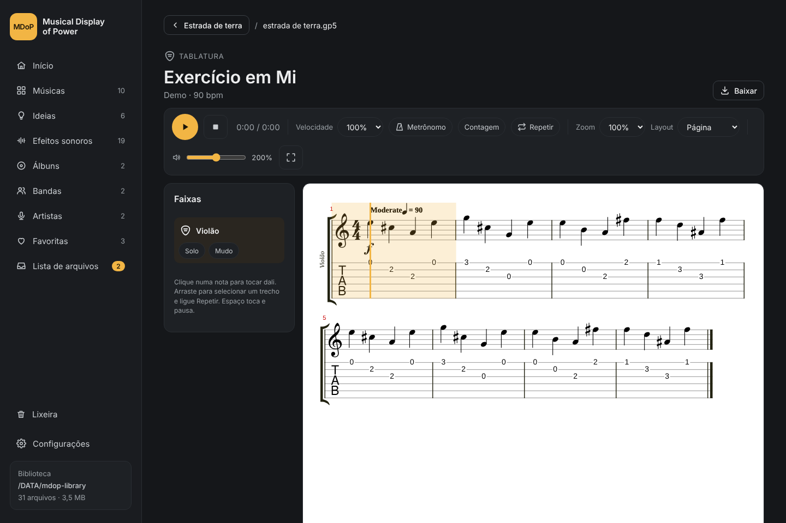 | 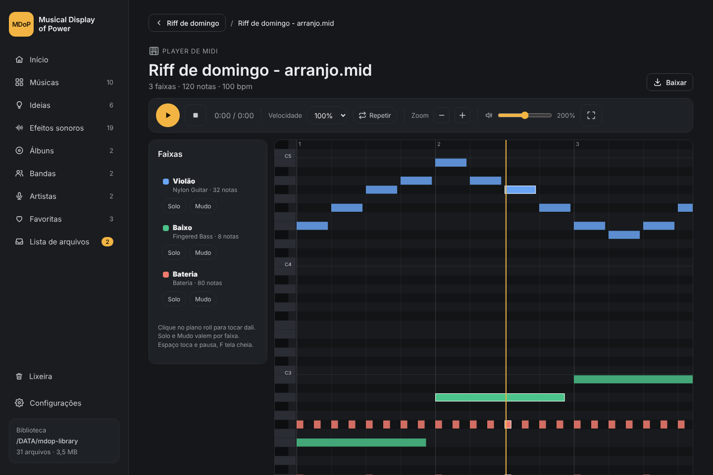 | 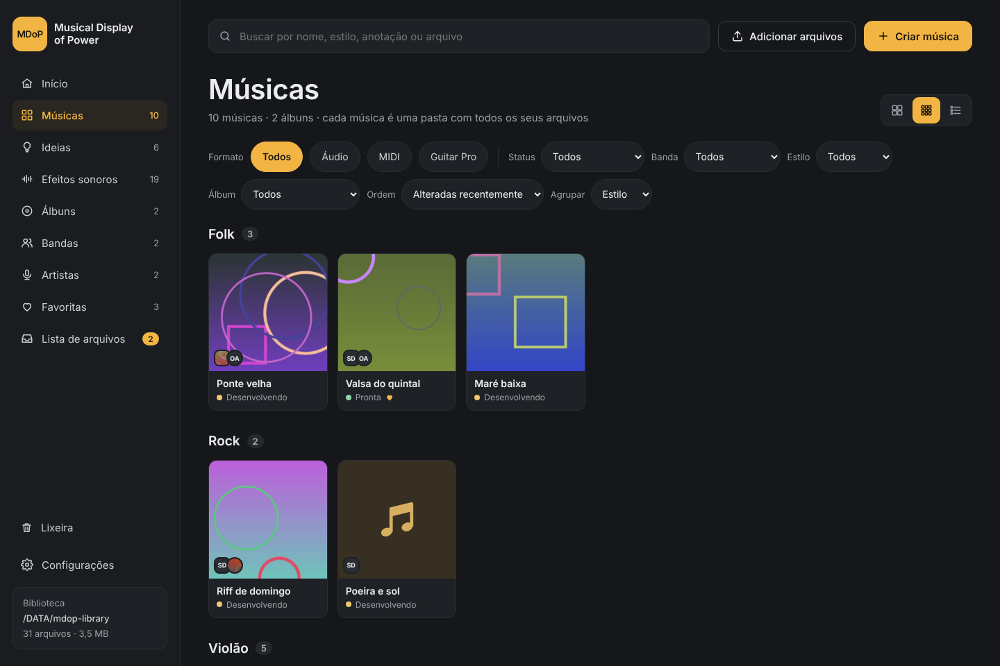 |

| Artista | Tema claro | Tema Vidro |
|---|---|---|
| 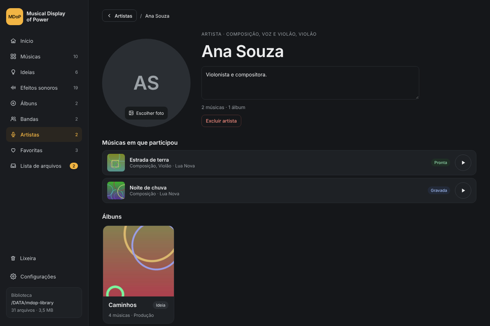 | 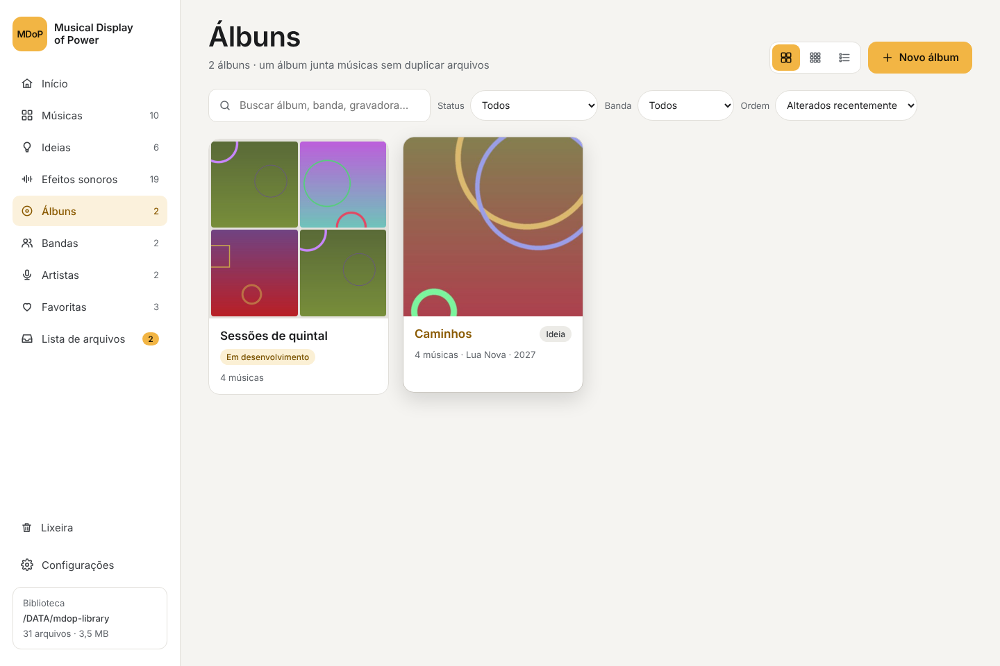 | 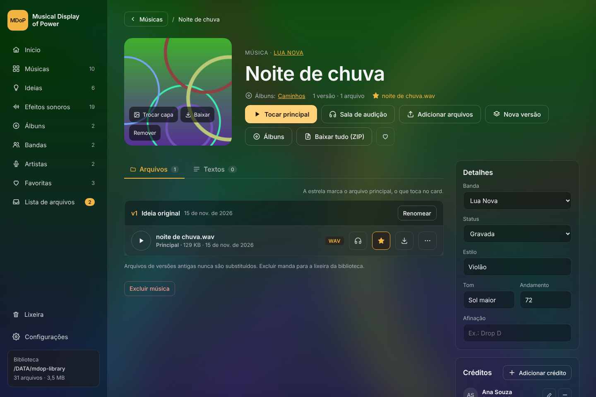 |

## Instalação rápida (Docker)

Você precisa de um servidor Linux com Docker e Docker Compose (o CasaOS, por exemplo, já vem com os dois). Há uma imagem pronta para **amd64** (a maioria dos PCs e servidores) e **arm64** (Raspberry Pi 4/5 e parecidos).

```bash
git clone https://github.com/carvalhopecanha/musical-display-of-power.git
cd musical-display-of-power
./install.sh
```

O instalador fala português ou inglês (segue o idioma do sistema), faz cinco perguntas e cuida do resto: cria as pastas com o dono certo, escreve o arquivo `.env`, baixa a imagem e sobe o container.

1. **Pasta da biblioteca:** onde o MDoP guarda as músicas organizadas.
2. **Pasta de importação:** a pasta com os arquivos que você já tem, que aparece em *Adicionar arquivos → Do servidor*.
3. **Pasta de efeitos sonoros** (opcional): a raiz da sua biblioteca de SFX, liberada só para leitura.
4. **Pasta de backups:** onde os backups ficam (de preferência outro HD).
5. **Porta:** ele avisa se ela já estiver em uso.

No fim, ele mostra o endereço para abrir no navegador, como `http://192.168.1.10:8090`. O container volta sozinho quando o servidor reinicia.

> Prefere fazer à mão? Copie o `.env.example` para `.env`, ajuste os caminhos e rode `docker compose up -d`. Para montar a imagem você mesmo em vez de baixar, use `./install.sh --build` ou `docker compose up -d --build`.

**Leia o [guia de uso](docs/guia.md)** para um passeio completo, da primeira importação ao backup.

### Atualizar

```bash
git pull
./install.sh       # responda "n" para manter a configuração
```

O banco de dados se atualiza sozinho, e a atualização nunca altera os seus arquivos de música.

### Mudar a biblioteca de disco

```bash
./install.sh move
```

Ele copia tudo para a pasta nova, confere se a quantidade e o tamanho dos arquivos batem e só então troca. A pasta antiga fica até você apagar.

### Esqueci a senha

```bash
sudo docker exec mdop python -m app disable-password
```

## Rodando sem Docker

Precisa de Python 3.11 ou mais novo.

```bash
python3 -m venv .venv
source .venv/bin/activate            # Windows: .venv\Scripts\activate
pip install -r requirements.txt
MDOP_LIBRARY=~/mdop-library MDOP_IMPORT_ROOTS=~/Música python -m app
```

| Variável | Para que serve | Padrão |
|---|---|---|
| `MDOP_LIBRARY` | Pasta da biblioteca | `./library` |
| `MDOP_IMPORT_ROOTS` | Pastas navegáveis em "Do servidor" (separe várias com `:`) | nenhuma |
| `MDOP_PORT` | Porta | `8090` |
| `MDOP_HOST` | Endereço de escuta | `0.0.0.0` |
| `MDOP_SFX_ROOTS` | Pastas raiz dos efeitos, só leitura (separe com `:`) | nenhuma |
| `MDOP_BACKUP_DIR` | Onde os backups ficam | `mdop-backups` ao lado da biblioteca |
| `MDOP_MAX_UPLOAD_MB` | Maior arquivo aceito por envio pelo navegador (`0` = sem limite) | `2048` |

## Seus arquivos continuam legíveis

A biblioteca é feita de pastas comuns, então dá para abrir sem o MDoP:

```
mdop-library/
├── inbox/              arquivos esperando na Lista de arquivos
├── ideas/              ideias (mesma estrutura de uma música)
├── songs/              músicas
│   └── riff-de-domingo/
│       ├── cover.jpg   capa
│       ├── v1/         riff de domingo.m4a, riff de domingo.mid
│       └── v2/         ponte nova.mp3
├── albums/  bands/  artists/
├── .trash/             lixeira (restaurável pela tela Lixeira)
└── .mdop/mdop.db       banco de dados SQLite
```

**Backup:** use *Configurações → Backup*, ou copie a pasta da biblioteca inteira. Veja o [guia de uso](docs/guia.md#15-backup-atualizações-e-mudar-a-biblioteca-de-lugar).

## Segurança

O MDoP foi feito para a **rede de casa**. Mesmo com senha, a conexão local é `http` comum. Depois de 5 senhas erradas, o aparelho precisa esperar 5 minutos. As pastas de efeitos entram só para leitura. Não abra a porta no roteador; para acessar de fora, use uma VPN como o [Tailscale](https://tailscale.com) ou o WireGuard.

## Próximos passos

- Versão para computador (Windows, macOS e Linux), com instalador e "abrir com o programa padrão".
- Gerar MIDI a partir do áudio dentro do app ([Basic Pitch](https://github.com/spotify/basic-pitch)).
- Editor de tablatura.

Veja o [histórico de versões](CHANGELOG.md).

## Desenvolvimento

```bash
pip install -r requirements.txt -r requirements-dev.txt
python -m pytest
```

O backend é FastAPI com SQLite (`app/`). A interface é HTML, CSS e JavaScript puro, sem etapa de build (`app/static/`). Veja o [CONTRIBUTING.md](CONTRIBUTING.md).

## Bibliotecas de terceiros

Vêm dentro de `app/static/vendor/` para tudo funcionar sem internet:

- [wavesurfer.js](https://wavesurfer.xyz) 7: BSD-3-Clause
- [alphaTab](https://alphatab.net) 1.9: MPL-2.0
- Fonte musical Bravura (SMuFL): SIL Open Font License
- Banco de sons Sonivox: Apache-2.0

Cada licença está junto dos arquivos.

## Licença

[MIT](LICENSE)
