# Guia de uso do MDoP

[English](guide.md) · **Português**

Este guia percorre o MDoP da primeira importação ao backup. Se ainda não instalou, comece pelo [README](../README.pt-BR.md#instalação-rápida-docker).

- [1. A ideia em um minuto](#1-a-ideia-em-um-minuto)
- [2. Adicionando seus arquivos](#2-adicionando-seus-arquivos)
- [3. Lista de arquivos: da pilha às músicas](#3-lista-de-arquivos-da-pilha-às-músicas)
- [4. Ideias](#4-ideias)
- [5. Efeitos sonoros](#5-efeitos-sonoros)
- [6. Músicas](#6-músicas)
- [7. Álbuns, bandas e artistas](#7-álbuns-bandas-e-artistas)
- [8. Achando as coisas](#8-achando-as-coisas)
- [9. Sala de audição](#9-sala-de-audição)
- [10. Visualizador de tablatura](#10-visualizador-de-tablatura)
- [11. Player de MIDI](#11-player-de-midi)
- [12. A barra do player](#12-a-barra-do-player)
- [13. Lixeira](#13-lixeira)
- [14. Configurações](#14-configurações)
- [15. Backup, atualizações e mudar a biblioteca de lugar](#15-backup-atualizações-e-mudar-a-biblioteca-de-lugar)
- [16. Problemas comuns](#16-problemas-comuns)

## 1. A ideia em um minuto

O MDoP organiza a música **que você faz**. As peças são:

| Peça | O que é |
|---|---|
| **Lista de arquivos** | Uma caixa de entrada. Tudo que você importa pode cair aqui primeiro, solto, até você decidir o que é. |
| **Ideia** | Um riff, melodia, harmonia, escala ou exercício que ainda não é música. Fica na aba Ideias com os arquivos, um tipo e anotações, até você transformar em música. |
| **Música** | Uma pasta com todos os arquivos de uma música: takes de áudio, MIDI, tablaturas do Guitar Pro, imagens, textos. |
| **Versão** | Uma subpasta da música (`v1`, `v2`…). Ideia nova para a ponte? Versão nova. Arquivos antigos nunca são substituídos. |
| **Arquivo principal** | O arquivo marcado com a estrela. É o que toca quando você aperta o play no card da música. |
| **Álbum** | Uma lista de músicas em ordem. As músicas são ligadas, não copiadas, então uma música pode estar em vários álbuns. |
| **Banda** | Um grupo ou projeto. Músicas e álbuns podem ser de uma banda; artistas podem ser integrantes dela. |
| **Artista** | Uma pessoa. Credite nas músicas, álbuns e bandas, com a função (composição, guitarra, arte da capa…). |
| **Status** | Em que pé está uma música: desenvolvendo → pronta → gravada. Os álbuns também têm "ideia" como primeiro passo. |

Tudo fica no disco como pastas comuns dentro da pasta da biblioteca, então seus arquivos continuam legíveis mesmo sem o MDoP.

## 2. Adicionando seus arquivos

Clique em **Adicionar arquivos** (no alto, à direita, na maioria das telas). Você escolhe duas coisas: de **onde** os arquivos vêm e para **onde** eles vão.

**De onde**
- **Do meu computador:** escolha arquivos ou uma pasta inteira, ou arraste para a janela.
- **Do servidor:** navegue pela pasta de importação escolhida na instalação e marque arquivos ou pastas inteiras. É o jeito mais rápido de trazer centenas de arquivos.

**Para onde**
- **Lista de arquivos** *(recomendado)*: os arquivos entram soltos para você ouvir e decidir depois. Ideal para muitos arquivos.
- **Criar uma nova música:** tudo que você escolheu vira uma música.
- **Adicionar a uma música:** os arquivos vão para uma música que já existe (e para a versão que você escolher).
- **Uma música por nome:** arquivos com o mesmo nome viram uma música. Por exemplo, `riff 1.m4a` e `riff 1.mid` viram a música "riff 1".

**Os originais** (só quando vêm do servidor)
- **Manter os originais e fazer uma cópia** *(recomendado)*: seus arquivos continuam onde estão.
- **Mover para a biblioteca:** economiza espaço; os arquivos saem da pasta antiga. Precisa de permissão de escrita nela. Sem permissão, o MDoP copia e avisa.

Na importação pelo servidor, arquivos que já foram importados são pulados, então dá para trazer a mesma pasta duas vezes sem medo.

## 3. Lista de arquivos: da pilha às músicas

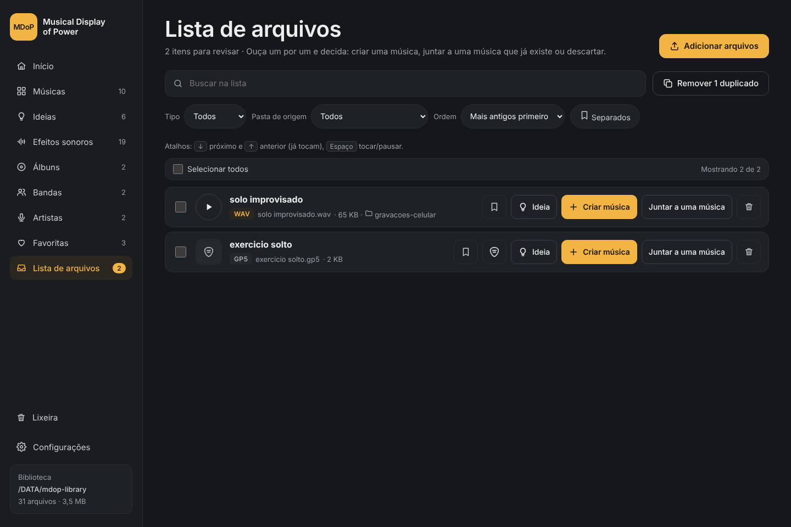

É aqui que uma pilha de gravações vira biblioteca. Arquivos com o mesmo nome (`ideia 2.wav` + `ideia 2.mid`) aparecem juntos, como um item só.

- **Ouça:** clique no play e use **↑ / ↓** para ir ao item anterior ou ao próximo (ele já começa a tocar). **Espaço** pausa.
- **Decida** para cada item:
  - **Ideia** (lâmpada): manda para [Ideias](#4-ideias) com um tipo, como riff ou melodia. Selecione vários itens para cada um virar uma ideia própria de uma vez.
  - **Criar música:** vira uma música (você dá o nome e pode escolher a banda).
  - **Juntar a uma música:** vai para uma música que já existe, como versão nova se quiser.
  - **Descartar** (lixeira): vai para a Lixeira.
- **Separe** (ícone de marcador) os promissores numa primeira passada, e ligue o filtro *Separados* na segunda.
- **Filtros:** busca por nome, tipo (áudio, MIDI, Guitar Pro…), **pasta de origem** e ordenação.
- **Remover duplicados idênticos:** aparece quando o MDoP acha arquivos que são cópias exatas, com mesmo tamanho e mesmo conteúdo byte a byte, mesmo com nomes diferentes. Sempre fica uma cópia de cada. Arquivos de tamanhos diferentes nunca contam como duplicados.
- Arquivos MIDI e Guitar Pro da lista abrem no [player de MIDI](#11-player-de-midi) e no [visualizador de tablatura](#10-visualizador-de-tablatura) antes de você decidir.

Depois de cada decisão, o próximo item começa a tocar.

## 4. Ideias

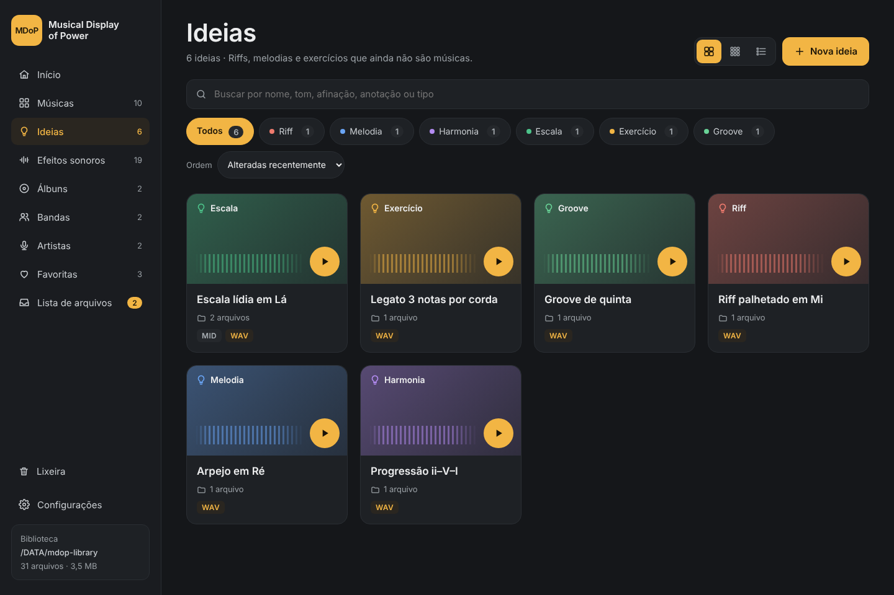

Quase tudo que a gente grava ainda não é música: um riff, uma melodia, uma progressão de acordes, uma escala, um exercício. A aba **Ideias** guarda isso separado das músicas, para a tela *Músicas* mostrar só músicas.

**Como as ideias entram**
- Pela **Lista de arquivos**, com o botão **Ideia** (lâmpada): escolha o tipo e, se for um item só, um nome de trabalho. Selecione vários itens para criar uma ideia para cada um de uma vez.
- Ou em **Nova ideia**, adicionando os arquivos depois.

**A tela Ideias**
- **Os botões de tipo** filtram por riff, melodia, harmonia, escala, exercício ou os tipos que você criar (use *Novo tipo…* em qualquer lista de tipos). Só aparecem os tipos em uso.
- Busca por nome, tom, afinação, anotações ou tipo, filtro por tom, ordenação e os modos cards, miniaturas e lista.

**A página de uma ideia**

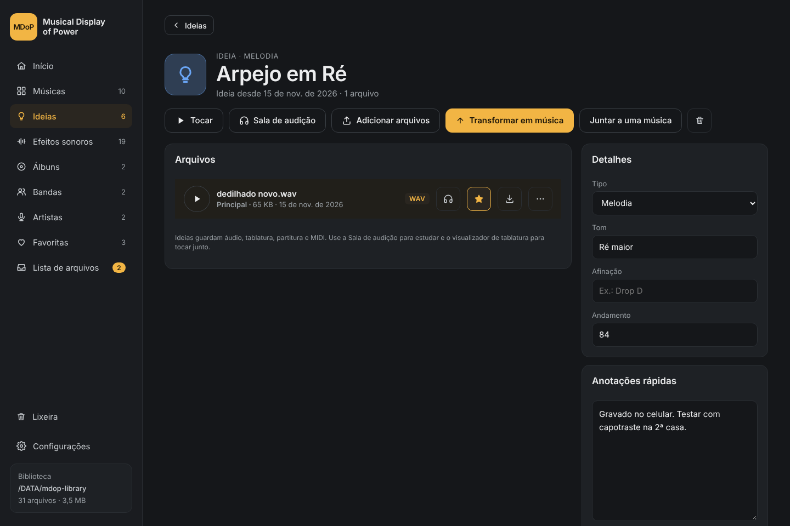

- **Arquivos:** áudio, Guitar Pro, MusicXML e MIDI. Não tem capa; ideia é sobre o som. Toque, abra na Sala de audição, no visualizador de tablatura ou no player de MIDI, e marque o principal com a estrela.
- **Detalhes:** tipo, tom, afinação e andamento. As **anotações** salvam enquanto você digita: acordes, digitação, para onde a ideia pode ir.
- **Transformar em música:** escolha nome, estilo e banda. A ideia sai da aba Ideias e vira uma música em "desenvolvendo", com todos os arquivos, anotações e marcadores. O painel Detalhes da música passa a mostrar quando ela nasceu como ideia e quando virou música.
- **Juntar a uma música:** para quando o riff vira a ponte de uma música que já existe. Os arquivos entram nela como versão nova ("Da ideia: …"), as anotações viram um texto da música, e a ideia deixa de existir.
- **Excluir:** manda para a Lixeira, de onde ela volta como ideia.

Ideias não entram em álbuns; transforme em música antes.

## 5. Efeitos sonoros

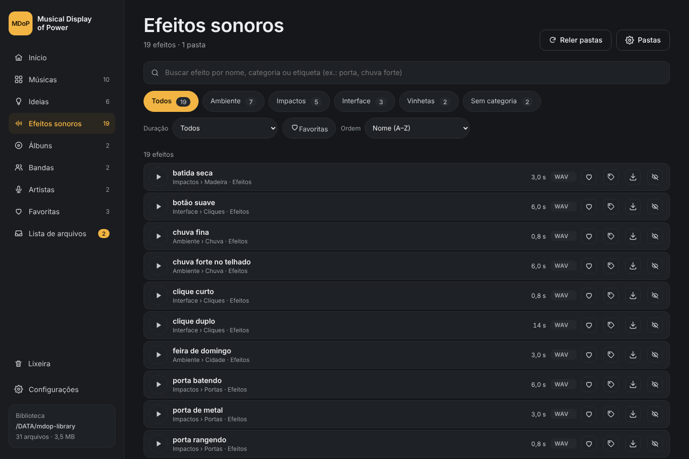

Uma biblioteca de efeitos passa fácil de dezenas de gigabytes, então o MDoP não copia nada: ele **vincula as suas pastas** e só lê. Guarda nome, duração, formato e categoria de cada efeito, e nunca copia, altera ou apaga os arquivos.

**Como configurar**
1. Na instalação, o `./install.sh` pergunta a **pasta raiz dos seus efeitos** (pode ser um HD inteiro). Ela é liberada para o MDoP **só para leitura**. Dá para deixar em branco e rodar o instalador de novo depois.
2. Em **Configurações → Efeitos sonoros** (ou na própria tela de efeitos), clique em **Vincular pasta** e escolha uma ou mais pastas dentro dessa raiz.
3. O MDoP lê as pastas em segundo plano. As subpastas viram **categorias**: `Ambiente/Chuva/chuva forte.wav` entra na categoria *Ambiente*, subcategoria *Chuva*.

**Achar e ouvir**
- Busque por nome, categoria ou etiqueta; filtre por categoria, subcategoria, duração (curtos, médios, longos, muito longos), formato, etiqueta e favoritos; ordene por nome, duração, adicionados recentemente ou aleatório.
- Clique para ouvir. **↑ ↓** passam para o próximo efeito e já tocam; **Espaço** pausa. Listas longas carregam conforme você rola.
- **Etiquetas** (ícone de etiqueta) e **favoritos** são seus e ficam guardados com o efeito. **Baixar** leva o arquivo para o seu editor.
- **Tirar da lista** (o olho riscado) esconde o efeito; o arquivo continua na pasta. Em *Configurações → Efeitos sonoros* dá para devolver os escondidos.

**Manter atualizado**
- **Reler pastas** acha os efeitos novos e marca os que sumiram. Só relê o que mudou, então é rápido mesmo em bibliotecas grandes.
- Se um HD estiver desconectado, os efeitos dele aparecem como **indisponíveis** em vez de sumirem, e voltam na próxima leitura com o HD conectado.
- **Desvincular** uma pasta tira os efeitos dela do MDoP (com etiquetas e favoritos); os arquivos ficam intactos.

A busca geral do Início também encontra efeitos.

## 6. Músicas

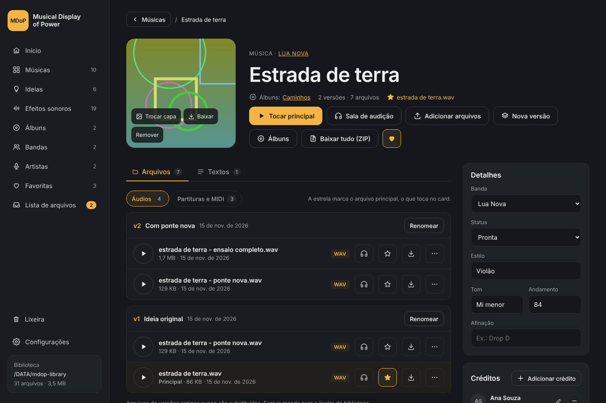

**Capa.** Música sem imagem mostra duas colcheias (♫). Adicione ou troque a imagem na página da música quando quiser. Se a música está num álbum ou é de uma banda, aparecem no card pequenos **círculos** com a capa do álbum e a foto da banda: passe o mouse para ver o nome e clique para abrir o álbum ou a banda (no celular, o toque já abre). Com mais de um álbum, um "+1" mostra os outros.

**Aba Arquivos.** Os arquivos ficam separados por tipo: *Áudios*, *Partituras e MIDI*, *Imagens*, *Outros* (só aparecem os tipos que a música tem). Dentro, ficam agrupados por versão, da mais nova para a mais antiga.

- **Estrela:** marca o arquivo principal.
- **Ícone de fone** (áudios): abre o arquivo na [Sala de audição](#9-sala-de-audição).
- **Ícone de palheta** (Guitar Pro e MusicXML): abre o [visualizador de tablatura](#10-visualizador-de-tablatura).
- **Play nos arquivos MIDI:** abre o [player de MIDI](#11-player-de-midi).
- **Menu ⋯:** renomear o arquivo, mover para outra versão ou excluir.
- **Imagens:** qualquer imagem pode virar a capa com **Usar como capa**.
- **Nova versão:** cria `v2`, `v3`… e você adiciona arquivos direto nela.

**Aba Textos.** Anotações livres que salvam enquanto você digita: estrutura, letra, ideias, acordes. Títulos sugeridos ajudam a começar.

**Painéis do lado**
- **Detalhes:** banda, status, estilo, tom, andamento e afinação.
- **Créditos:** artistas com a função de cada um. Digite o nome; se o artista não existir, ele é criado.
- **Anotações:** um rascunho rápido.

**No alto da página:** capa (adicionar, trocar, baixar, remover), *Tocar principal*, *Sala de audição*, *Adicionar arquivos*, *Nova versão*, *Álbuns* (em quais álbuns a música está), **Baixar tudo (ZIP)** com todas as versões, a capa e os textos, e o coração para favoritar.

## 7. Álbuns, bandas e artistas

**Álbuns**
- Crie em **Novo álbum**, depois adicione músicas e ordene com as setas.
- **Sem capa?** O álbum mostra um mosaico com as capas das músicas.
- **Ficha técnica:** lançamento, local de gravação, gravadora/selo, status (ideia, em desenvolvimento, pronto, gravado) e créditos (produção, arte da capa, participações…).
- **Baixe** o álbum inteiro em ZIP, com uma pasta por faixa.

**Bandas** agrupam músicas e álbuns. Na página da banda, adicione os integrantes; eles são créditos com função, como "vocal" ou "baixo".

**Artistas** são pessoas. A página de cada artista lista todas as músicas, álbuns e bandas de que participou, com as funções.

As três telas têm busca e os três modos de exibição. Álbuns também filtram por status e banda.

## 8. Achando as coisas

- **Início:** uma busca geral em músicas, álbuns, bandas, artistas e Lista de arquivos. Embaixo dela ficam:
  - o acervo por status (clique numa cor para ver aquelas músicas);
  - os arquivos por tipo;
  - uma música sorteada para redescobrir;
  - as alteradas recentemente, favoritas, álbuns e bandas.
- **Músicas:** busca por nome, estilo, anotações, nome de arquivo ou nome de artista. Filtros por formato, status, banda, estilo e álbum, e ordenação.
- **Agrupar:** em *Músicas*, agrupe por **estilo** (Metal, Podcast, Instrumental…), status ou banda.
- **Modos de exibição:** cards grandes, miniaturas ou lista, no canto de cada tela de lista. Cada tela lembra o seu modo. Listas longas carregam aos poucos conforme você rola.

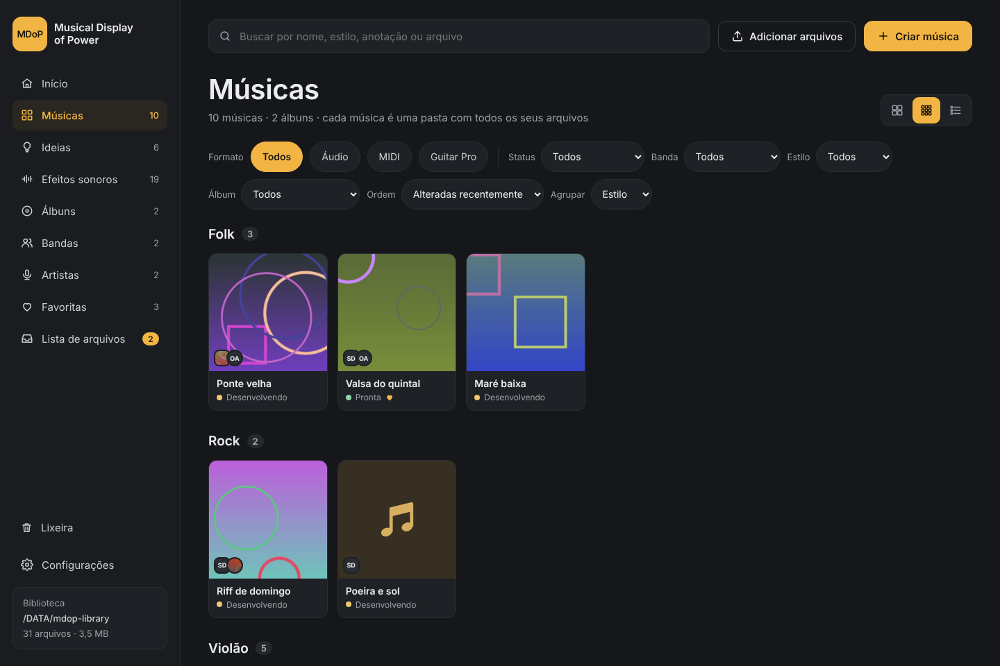

## 9. Sala de audição

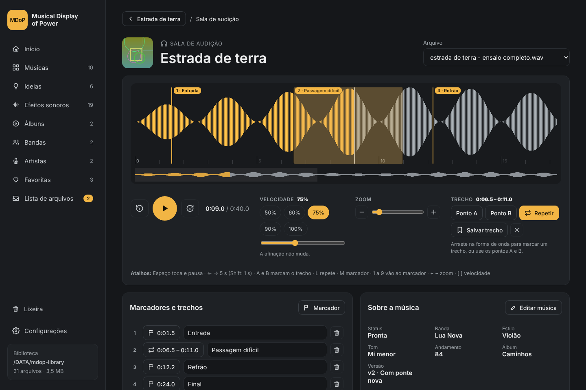

Feita para estudar uma gravação: tirar uma parte, conferir um take, achar o melhor momento.

**Como abrir:** pelo botão *Sala de audição* na página da música, pelo ícone de fone ao lado de um áudio, ou pelo fone na barra do player (continua do mesmo segundo).

**O que tem na tela**
- **Forma de onda:** dê zoom e use a faixa de baixo (minimapa) para ver onde você está na música inteira. Clique em qualquer ponto da onda para ir até ali.
- **Trecho em loop:** arraste na onda, ou aperte **A** e **B** no começo e no fim. Ele repete até você desligar. **Salvar trecho** guarda para depois.
- **Velocidade:** de 25% a 150%, e a afinação não muda.
- **Marcadores:** aperte **M** enquanto toca para marcar um momento. Dê nome aos marcadores e clique num deles para ir até lá. Marcadores e trechos ficam guardados por arquivo. Se o arquivo for para a Lixeira e voltar, eles voltam junto.
- **Embaixo:** tom, andamento, afinação, anotações, textos (letra, estrutura), créditos e os outros arquivos da música.

**Atalhos de teclado**

| Tecla | O que faz |
|---|---|
| Espaço | Toca / pausa |
| ← → | Volta / avança 5 s (Shift: 1 s) |
| A / B | Começo / fim do trecho |
| L | Liga / desliga a repetição |
| M | Novo marcador |
| 1–9 | Vai ao marcador 1–9 |
| + / − | Aproxima / afasta |
| [ / ] | Mais devagar / mais rápido |
| Home | Volta ao começo (ou ao começo do trecho) |

## 10. Visualizador de tablatura

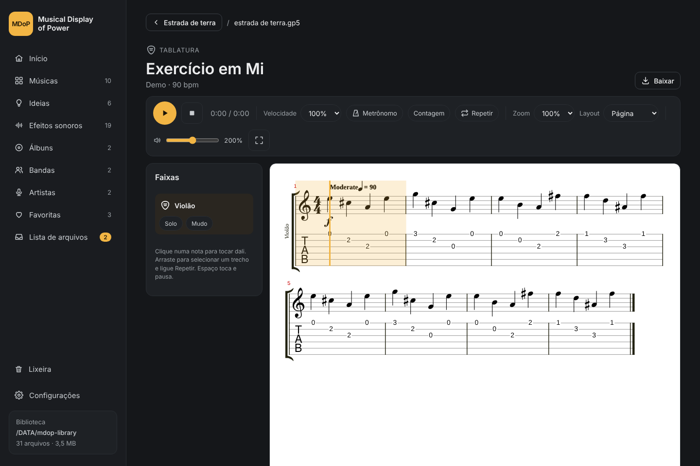

Abre **Guitar Pro 3 a 8** (`.gp3`, `.gp4`, `.gp5`, `.gpx`, `.gp`) e **MusicXML**, tanto das músicas quanto da Lista de arquivos.

- **Toca** com som de instrumento, e um cursor acompanha as notas.
- **Clique numa nota** para tocar dali. **Arraste** sobre as notas para selecionar um trecho e ligue **Repetir** para ele ficar repetindo.
- **Velocidade, metrônomo e contagem** para praticar junto.
- **Faixas:** mostre outra faixa, ou deixe cada uma em **Solo** ou **Mudo**.
- **Zoom** e **layout** (página ou uma linha horizontal).
- **Volume:** o banco de sons embutido é baixo, então começa em 200%. Sua escolha fica guardada.
- **Tela cheia:** o botão no fim da barra, ou **F**. Espaço toca e pausa.

Arquivos do TuxGuitar (`.tg`), `.gtp` antigos e PowerTab (`.ptb`) não abrem no visualizador; continuam disponíveis para baixar.

## 11. Player de MIDI

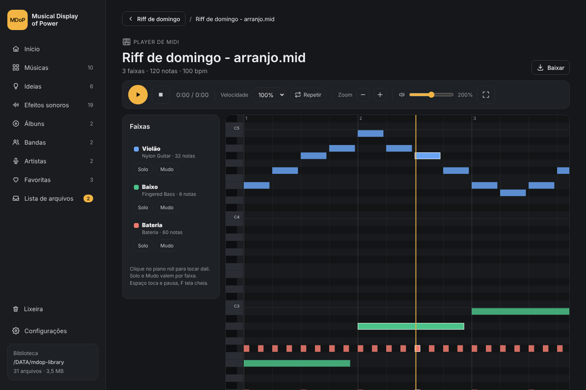

Toca arquivos `.mid` / `.midi` com o mesmo banco de sons da tablatura. O play num arquivo MIDI abre o player e já começa a tocar.

- **Piano roll:** cada faixa tem uma cor, e as notas acendem enquanto tocam. Clique em qualquer ponto para tocar dali.
- **Faixas:** nomes e instrumentos vêm do arquivo. **Solo** e **Mudo** valem por faixa.
- **Velocidade, repetir, zoom, volume, tela cheia (F)** e **Espaço** para tocar e pausar.

Um bom uso: converta suas ideias gravadas em MIDI com uma ferramenta como o [Basic Pitch](https://basicpitch.spotify.com), importe o MIDI junto do áudio e compare os dois aqui.

## 12. A barra do player

Quando você toca uma música, aparece embaixo um player compacto com um vinil girando. Ele tem anterior, próxima e fechar, e um botão de **fone** que leva a música atual para a Sala de audição, no mesmo ponto.

## 13. Lixeira

Excluir um arquivo, uma música ou um item da Lista de arquivos **move** para a pasta `.trash` da biblioteca. Na tela **Lixeira** você pode:
- **Restaurar** para onde estava. Músicas voltam com versões, textos, álbuns, créditos e marcadores. Se a música de um arquivo não existir mais, o arquivo volta para a Lista de arquivos.
- **Excluir para sempre** um item, ou **esvaziar** a lixeira inteira.
- Nada sai da Lixeira sozinho, a não ser que você escolha **Esvaziar a lixeira sozinho** em *Configurações → Biblioteca* (depois de 30 ou 90 dias).

## 14. Configurações

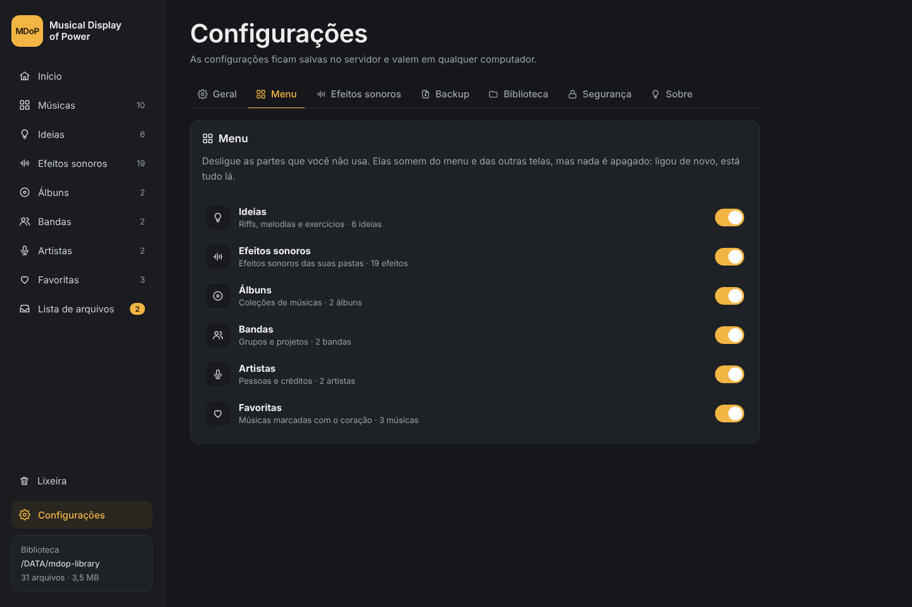

As configurações são divididas em abas, e cada aba tem endereço próprio (por exemplo `#/settings/backup`), então dá para salvar nos favoritos.

- **Geral:** idioma (automático segue o navegador, ou português ou inglês), tema (escuro, claro ou **Vidro**) e cor de destaque (amarelo, azul, verde, vermelho ou roxo). O Vidro mostra uma capa desfocada atrás de painéis translúcidos: a capa da página aberta, ou a da música tocando, ou uma imagem que você escolher.
- **Menu:** desligue as partes que você não usa: Ideias, Efeitos sonoros, Álbuns, Bandas, Artistas e Favoritas. Elas somem do menu e das outras telas (botões, fileiras do Início, busca, círculos dos cards), mas **nada é apagado**: ligou de novo, está tudo lá.
- **Efeitos sonoros:** pastas vinculadas, reler pastas e devolver efeitos escondidos.
- **Backup:** criar, baixar, enviar e restaurar backups (veja abaixo).
- **Biblioteca:** onde ela está no servidor, quanto ocupa e quanto sobra no disco, as pastas de importação e o **esvaziamento automático da lixeira** (desligado por padrão).
- **Segurança:** criar usuário e senha (opcional), trocar a senha, sair ou remover a proteção. Depois de 5 senhas erradas, aquele aparelho espera 5 minutos para tentar de novo.
- **Sobre:** versão e página do projeto.

As configurações ficam no servidor e valem para todo computador e celular. Os modos de exibição e o volume da tablatura e do MIDI ficam guardados em cada navegador.

## 15. Backup, atualizações e mudar a biblioteca de lugar

**Backup.** Em **Configurações → Backup**:

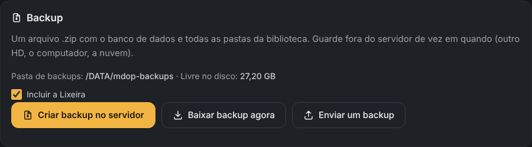

- **Criar backup no servidor** salva um `.zip` com o banco de dados e todas as pastas da biblioteca na **pasta de backups** escolhida na instalação (de preferência outro HD). Dá para continuar usando o app enquanto ele é criado.
- **Baixar backup agora** manda o mesmo `.zip` direto para o seu computador. Bom para bibliotecas pequenas ou para ter uma cópia fora do servidor.
- **Incluir a Lixeira** vem ligado; desligue para um backup menor.
- O `.zip` não é compactado de novo (áudio já vem comprimido), então é rápido e fica do tamanho da biblioteca.

**Restaurar.** Ao lado de cada backup guardado tem **Restaurar**. Antes, o MDoP guarda uma **cópia de segurança** da biblioteca atual (`before-restore-….zip`) e só então troca a biblioteca pela do backup. Uma tela de espera cobre o app até terminar. Backups de versões antigas do MDoP são atualizados na hora. Para restaurar um backup que está no seu computador, use antes **Enviar um backup**; ele aparece na lista.

A biblioteca também é feita de pastas comuns, então copiar a pasta da biblioteca na mão continua valendo como backup.

**Atualizações.** Na pasta do MDoP:

```bash
git pull
./install.sh         # responda "n" para manter a configuração
```

O instalador baixa a imagem pronta (ou monta, se não conseguir baixar), e o banco de dados se atualiza sozinho ao iniciar. A atualização nunca altera os seus arquivos de música.

**Vindo de uma versão antiga** (pastas `musicas`, `ideias`, `.lixeira`…)? Na primeira vez que abrir, o MDoP renomeia as pastas da biblioteca para nomes em inglês (`songs`, `ideas`, `.trash`…), com uma tela de espera. Antes disso, ele guarda uma cópia do banco em `.mdop/` e, se houver espaço, um backup completo (`before-update-….zip`) na pasta de backups. Nada é apagado, todos os arquivos são conferidos depois, e se algo não bater, tudo é desfeito e a biblioteca fica exatamente como estava. O seu `.env` antigo e o `./instalar.sh` continuam funcionando.

**Mudar a biblioteca** para outro disco:

```bash
./install.sh move
```

Ele copia, confere a quantidade e o tamanho dos arquivos, troca, e mantém a pasta antiga até você apagar.

## 16. Problemas comuns

**A página não abre.** Confira se o container está rodando com `sudo docker ps` (procure `mdop`) e se o IP e a porta estão certos. Registros: `sudo docker logs mdop`.

**"Permissão negada" ao instalar ou importar.** A pasta da biblioteca precisa ser do usuário do `.env` (`PUID`/`PGID`). Rode `./install.sh` de novo, ou `sudo chown -R $(id -u):$(id -g) /caminho/da/biblioteca`. Se você extraiu uma versão com `sudo tar`, corrija o dono da pasta do MDoP do mesmo jeito.

**Não vejo meus arquivos em "Do servidor".** Só aparece a pasta de importação escolhida na instalação (`MDOP_IMPORT` no `.env`). Troque no `.env` ou rode `./install.sh` de novo e responda "s".

**Um áudio aparece como "somente download".** O navegador não toca esse formato (comum com `.amr`, `.wma` e alguns `.aif`). Converta para mp3, m4a ou wav.

**Efeitos sonoros diz que nenhuma pasta foi liberada.** Nenhuma pasta de efeitos foi informada ao MDoP. Rode `./install.sh`, responda "s" para refazer as perguntas e informe a pasta raiz dos seus efeitos.

**"A pasta de backups não aceita gravação".** A pasta de backups precisa ser do usuário do `.env` (`PUID`/`PGID`). Rode `./install.sh` de novo (ele corrige o dono) ou escolha outra pasta.

**Depois de atualizar, a página ficou estranha.** Recarregue forçando com **Ctrl+Shift+R** (Cmd+Shift+R no Mac).

**"Muitas tentativas".** Depois de 5 senhas erradas, o MDoP espera 5 minutos para aceitar aquele aparelho de novo.

**Esqueci a senha.**

```bash
sudo docker exec mdop python -m app disable-password
```

**Outra coisa?** Abra uma issue no GitHub contando o que você fez, o que esperava e o que aconteceu.
