# MDoP user guide

**English** · [Português](guia.md)

This guide walks through MDoP from the first import to backups. If you haven't installed it yet, start with the [README](../README.md#quick-start-docker).

- [1. The idea in one minute](#1-the-idea-in-one-minute)
- [2. Adding your files](#2-adding-your-files)
- [3. The File list: from pile to songs](#3-the-file-list-from-pile-to-songs)
- [4. Ideas](#4-ideas)
- [5. Sound effects](#5-sound-effects)
- [6. Songs](#6-songs)
- [7. Albums, bands and artists](#7-albums-bands-and-artists)
- [8. Finding things](#8-finding-things)
- [9. Listening room](#9-listening-room)
- [10. Tab viewer](#10-tab-viewer)
- [11. MIDI player](#11-midi-player)
- [12. The player bar](#12-the-player-bar)
- [13. Trash](#13-trash)
- [14. Settings](#14-settings)
- [15. Backup, updates and moving the library](#15-backup-updates-and-moving-the-library)
- [16. Troubleshooting](#16-troubleshooting)

## 1. The idea in one minute

MDoP organizes music **you make**. The building blocks are:

| Thing | What it is |
|---|---|
| **File list** | An inbox. Everything you import can land here first, loose, until you decide what it is. |
| **Idea** | A riff, melody, harmony, scale or exercise that isn't a song yet. It lives in the Ideas tab with its files, a type and notes, until you turn it into a song. |
| **Song** | A folder holding every file of one piece of music: audio takes, MIDI, Guitar Pro tabs, images, texts. |
| **Version** | A sub-folder of a song (`v1`, `v2`…). A new idea for the bridge? New version. Old files are never replaced. |
| **Main file** | The file marked with a star. It's what plays when you hit play on the song's card. |
| **Album** | A list of songs in order. Songs are linked, not copied, so one song can sit in several albums. |
| **Band** | A group or project. Songs and albums can belong to a band; artists can be its members. |
| **Artist** | A person. Credit them on songs, albums and bands, with a role (composition, guitar, cover art…). |
| **Status** | Where a song stands: in progress → ready → recorded. Albums also have "idea" as a first step. |

Everything lives on disk as normal folders inside your library folder, so your files stay readable even without MDoP.

## 2. Adding your files

Click **Add files** (top right on most pages). You choose two things: where the files come **from** and where they **go**.

**From**
- **My computer:** pick files or a whole folder, or drag them onto the window.
- **The server:** browse the import folder you chose during installation and tick files or entire folders. This is the fastest way to bring in hundreds of files.

**To**
- **File list** *(recommended)*: files arrive loose so you can listen and decide later. Best for big batches.
- **Create a new song:** everything you picked becomes one song.
- **Add to a song:** files go into an existing song (and into the version you choose).
- **One song per name:** files with the same name become one song. For example, `riff 1.m4a` and `riff 1.mid` become the song "riff 1".

**Originals** (only when importing from the server)
- **Keep the originals and make a copy** *(recommended)*: your files stay where they were.
- **Move to the library:** saves space; the files leave their old folder. This needs write permission on that folder. Without it, MDoP copies instead and tells you.

When importing from the server, files that were already imported are skipped, so it's safe to bring in the same folder twice.

## 3. The File list: from pile to songs

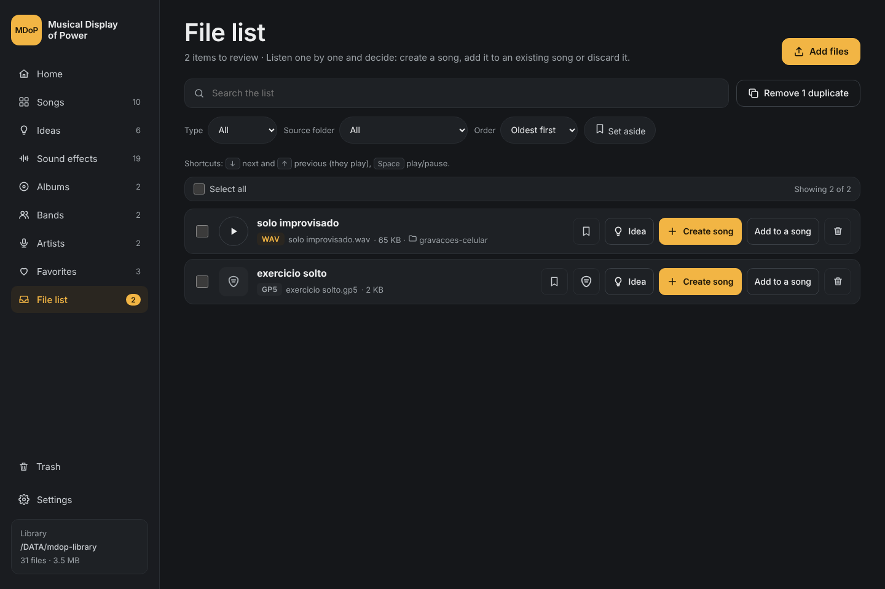

This is where a pile of recordings becomes a library. Files with the same name (`idea 2.wav` + `idea 2.mid`) appear together as one item.

- **Listen:** click play, then use **↑ / ↓** to move to the previous or next item (it starts playing right away) and **Space** to pause.
- **Decide** for each item:
  - **Idea** (light bulb): sends it to [Ideas](#4-ideas) with a type, such as riff or melody. Select several items to turn each one into its own idea at once.
  - **Create song:** creates a song from it (you can name it and pick a band).
  - **Add to a song:** puts it into an existing song, optionally as a new version.
  - **Discard** (trash icon): sends it to the Trash.
- **Set aside** (bookmark icon) the promising ones on a first pass, then turn on the *Set aside* filter for the second pass.
- **Filters:** search by name, filter by type (audio, MIDI, Guitar Pro…) and by **source folder**, and sort.
- **Remove identical duplicates:** appears when MDoP finds files that are exact copies of each other: same size and same content, byte for byte, even if the names differ. One copy of each always stays. Files of different sizes are never treated as duplicates.
- MIDI and Guitar Pro files in the list can be opened in the [MIDI player](#11-midi-player) or the [tab viewer](#10-tab-viewer) before you decide.

After each decision, the next item starts playing.

## 4. Ideas

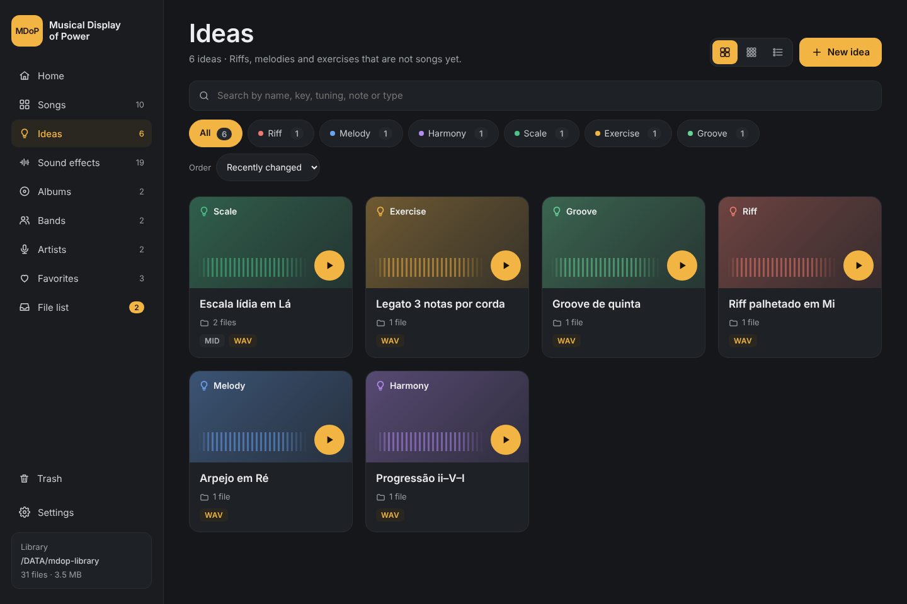

Most of what we record isn't a song yet: a riff, a melody, a chord progression, a scale or an exercise. The **Ideas** tab keeps those apart from your songs, so the *Songs* page only shows songs.

**Getting ideas in**
- From the **File list**, with the light-bulb **Idea** button: pick a type and, for a single item, a working name. Select several items to create one idea per item in one go.
- Or click **New idea** and add files to it.

**The Ideas page**
- **Type chips** filter by riff, melody, harmony, scale, exercise, or your own types (create one with *New type…* in any type list). Only the types in use appear.
- Search by name, key, tuning, notes or type, filter by key, sort, and switch between cards, thumbnails and a list.

**An idea's page**

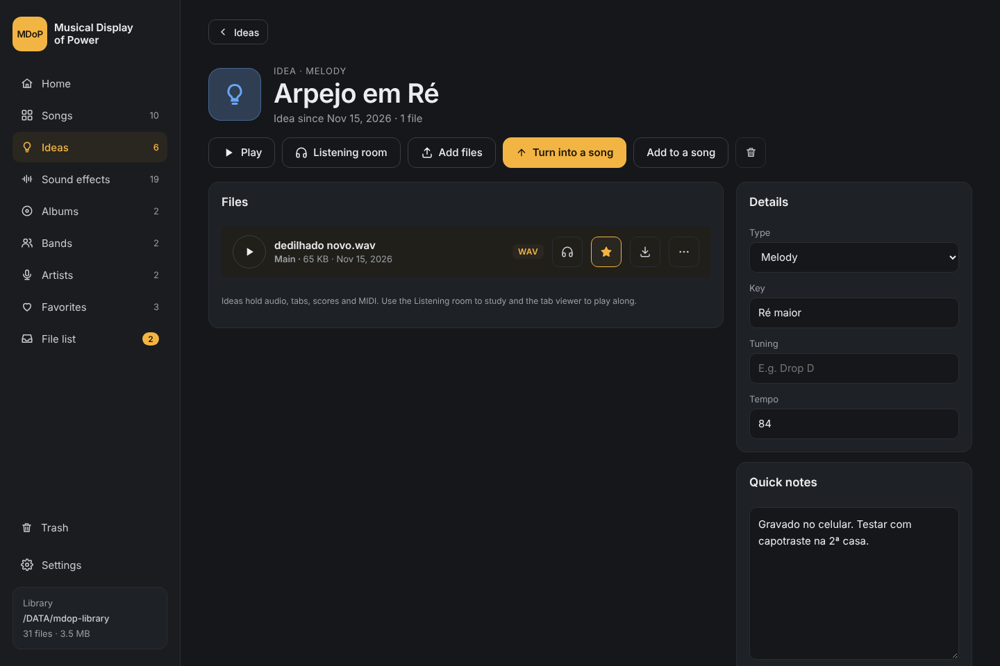

- **Files:** audio, Guitar Pro, MusicXML and MIDI. There's no cover; ideas are about the sound. Play them, open them in the Listening room, the tab viewer or the MIDI player, and mark the main file with the star.
- **Details:** type, key, tuning and tempo. **Notes** save as you type: chords, fingering, where the idea could go.
- **Turn into a song:** choose the song's name, style and band. The idea leaves the Ideas tab and becomes a song, in "in progress" status, with every file, note and marker. The song's Details panel then shows when it started as an idea and when it became a song.
- **Add to a song:** when a riff becomes the bridge of an existing song. Its files go into that song as a new version ("From the idea: …"), its notes become one of the song's texts, and the idea disappears.
- **Delete:** sends it to the Trash, where it can be restored as an idea.

Ideas can't be added to albums; turn them into songs first.

## 5. Sound effects

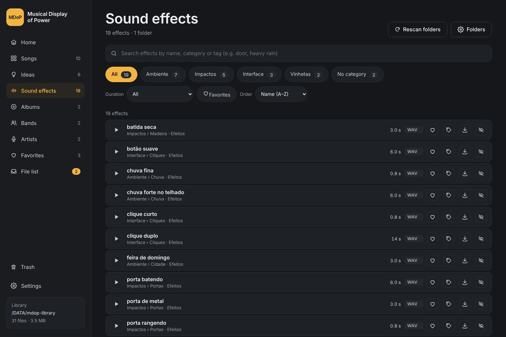

A library of sound effects can easily be tens of gigabytes, so MDoP doesn't copy it: it **links your folders** and only reads them. It stores each effect's name, duration, format and category, and never copies, changes or deletes the files.

**Setting it up**
1. During installation, `./install.sh` asks for the **root folder of your effects** (a whole drive is fine). It is made available to MDoP **read-only**. You can leave it empty and run the installer again later.
2. In **Settings → Sound effects** (or on the Sound effects page), click **Link folder** and choose one or more folders inside that root.
3. MDoP reads them in the background. Subfolders become **categories**: `Ambience/Rain/heavy rain.wav` lands in category *Ambience*, subcategory *Rain*.

**Finding and listening**
- Search by name, category or tag; filter by category, subcategory, duration (short, medium, long, very long), format, tag and favorites; sort by name, length, recently added or at random.
- Click to play. **↑ ↓** move to the next effect and play it right away; **Space** pauses. Long lists load as you scroll.
- **Tags** (the tag icon) and **favorites** are yours and stay with the effect. **Download** takes the file to your editor.
- **Remove from list** (the crossed-out eye) hides an effect; the file stays in the folder. *Settings → Sound effects* can bring hidden effects back.

**Keeping it up to date**
- **Rescan folders** finds new effects and marks the ones that disappeared. It only re-reads what changed, so it's quick even on big libraries.
- If a drive is disconnected, its effects show as **unavailable** instead of disappearing, and come back on the next rescan once the drive is connected again.
- **Unlinking** a folder removes its effects from MDoP (with their tags and favorites); the files are untouched.

The global search on the Home page also finds effects.

## 6. Songs

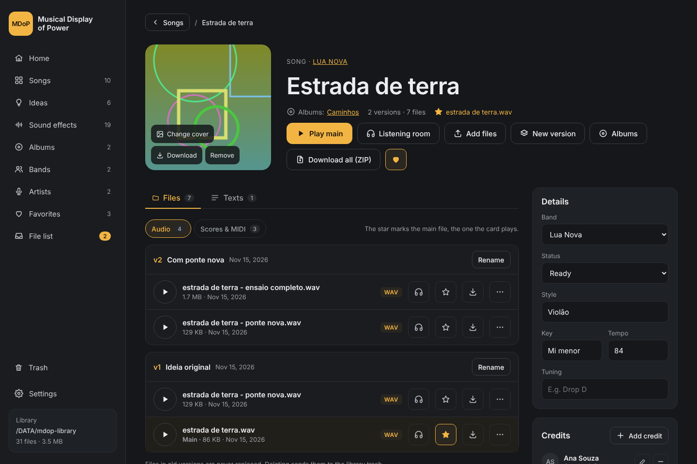

**Cover.** A song without an image shows two eighth notes (♫). Add or change the image on the song page whenever you like. If the song is on an album or belongs to a band, small **circles** with the album cover and the band photo appear on the card: hover to see the name, click to open the album or band (on a phone, a tap opens it). With more than one album, a "+1" shows the rest.

**Files tab.** Files are split by type: *Audio*, *Scores and MIDI*, *Images*, *Other* (only the types the song has are shown). Inside, they're grouped by version, newest first.

- **Star:** marks the main file.
- **Headphones icon** (audio files): opens the file in the [Listening room](#9-listening-room).
- **Pick icon** (Guitar Pro and MusicXML): opens the [tab viewer](#10-tab-viewer).
- **Play button on MIDI files:** opens the [MIDI player](#11-midi-player).
- **⋯ menu:** rename the file, move it to another version, or delete it.
- **Images:** use any image file as the song cover with **Use as cover**.
- **New version:** creates `v2`, `v3`… Add files straight into it.

**Texts tab.** Free-form notes that save as you type: song structure, lyrics, ideas, chords. Suggested titles help you start.

**Side panels**
- **Details:** band, status, style, key, tempo and tuning.
- **Credits:** add artists with their role. Type a name: if the artist doesn't exist, it's created.
- **Notes:** a quick scratchpad.

**Top of the page:** cover (add, change, download, remove), *Play main*, *Listening room*, *Add files*, *New version*, *Albums* (choose which albums include the song), **Download all (ZIP)** with every version, the cover and the texts, and the heart to favorite it.

## 7. Albums, bands and artists

**Albums**
- Create one with **New album**, then add songs and reorder them with the arrows.
- **No cover?** The album shows a mosaic made of its songs' covers.
- **Album details:** release, recording place, label, status (idea, in progress, ready, recorded) and credits (producer, cover art, guest musicians…).
- **Download** the whole album as a ZIP, one folder per track.

**Bands** group songs and albums. Add members on the band page; they're credits with a role, like "vocals" or "bass".

**Artists** are people. Each artist page lists every song, album and band they took part in, with their roles.

All three pages have a search box and the three view modes. Albums can also be filtered by status and band.

## 8. Finding things

- **Home:** a global search across songs, albums, bands, artists and the File list. Below it you'll find:
  - your collection by status (click a color to see those songs);
  - your files by type;
  - a random song to rediscover;
  - recently changed songs, favorites, albums and bands.
- **Songs:** search by name, style, notes, file name or artist name. Filter by format, status, band, style or album, and sort.
- **Group by:** in *Songs*, group by **style** (Metal, Podcast, Instrumental…), status or band.
- **View modes:** large cards, thumbnails or a list, at the top right of each list page. Each page remembers its own mode. Long lists load gradually as you scroll.

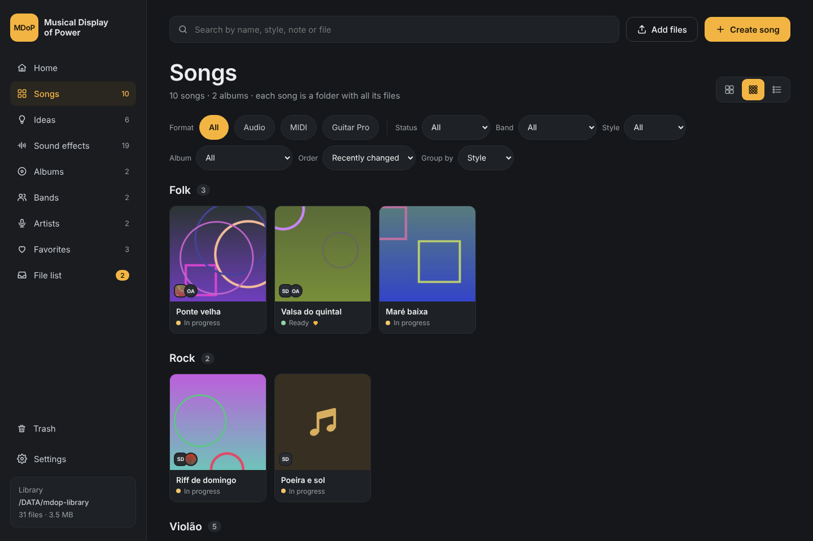

## 9. Listening room

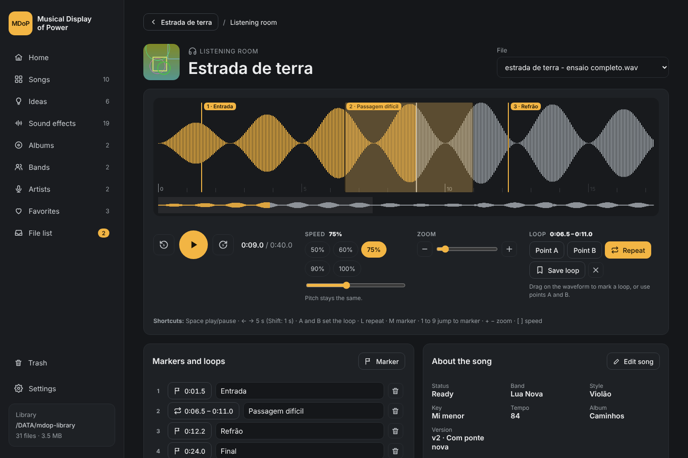

Made for studying a recording: learning a part, checking a take, finding the best moment.

**Opening it:** use *Listening room* on a song page, the headphones icon next to an audio file, or the headphones icon in the player bar (it continues from the same second).

**What's on the page**
- **Waveform:** zoom in, and use the strip below (minimap) to see where you are in the whole song. Click anywhere on the waveform to jump there.
- **Loop:** drag across the waveform, or press **A** and **B** at the start and end. It repeats until you turn it off. **Save loop** keeps it for later.
- **Speed:** 25% to 150%, and the pitch stays the same.
- **Markers:** press **M** while it plays to mark a moment. Name them, and click one to jump there. Markers and saved loops are kept per file. If the file goes to the Trash and comes back, they come back too.
- **Below:** the song's key, tempo, tuning, notes, texts (lyrics, structure), credits and its other files.

**Keyboard shortcuts**

| Key | Action |
|---|---|
| Space | Play / pause |
| ← → | Back / forward 5 s (Shift: 1 s) |
| A / B | Set loop start / end |
| L | Loop on / off |
| M | Add a marker |
| 1–9 | Jump to marker 1–9 |
| + / − | Zoom in / out |
| [ / ] | Slower / faster |
| Home | Back to the start (or to the loop start) |

## 10. Tab viewer

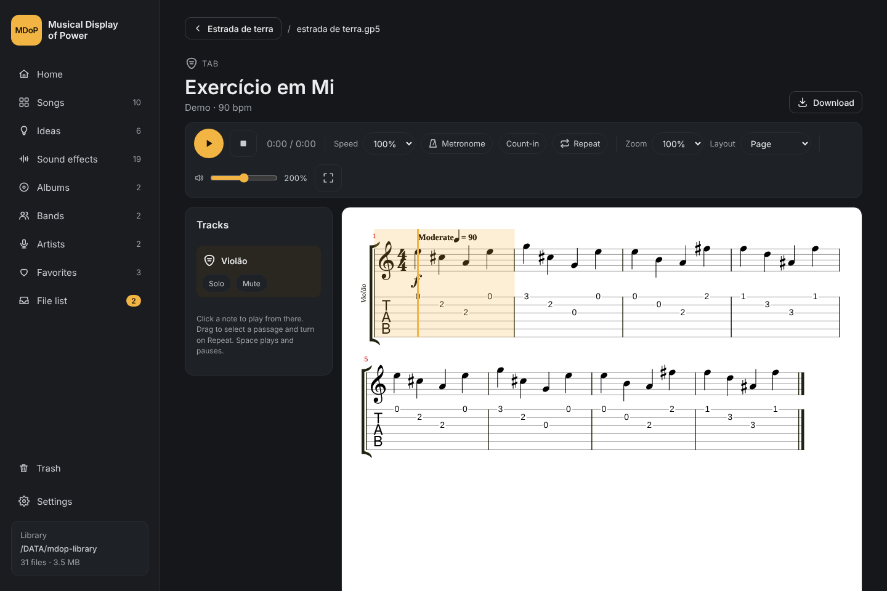

Opens **Guitar Pro 3 to 8** (`.gp3`, `.gp4`, `.gp5`, `.gpx`, `.gp`) and **MusicXML**, both from songs and from the File list.

- **Play** with real instrument sounds, while a cursor follows the notes.
- **Click a note** to play from there. **Drag** across notes to select a passage, then turn on **Repeat** to loop it.
- **Speed, metronome and count-in** for practicing along.
- **Tracks:** show another track, or **Solo** and **Mute** each one.
- **Zoom** and **layout** (page or one horizontal line).
- **Volume:** the built-in sound bank is quiet, so it starts at 200%. Your choice is remembered.
- **Full screen:** the button at the end of the toolbar, or **F**. Space plays and pauses.

TuxGuitar (`.tg`), old `.gtp` and PowerTab (`.ptb`) files can't be displayed; they remain available for download.

## 11. MIDI player

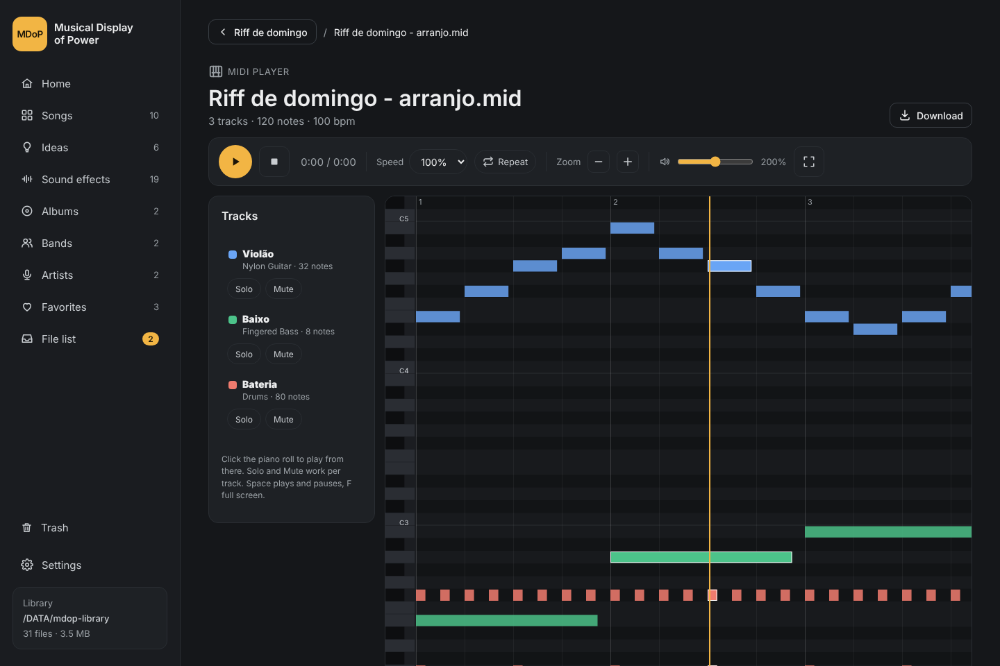

Plays `.mid` / `.midi` files with the same sound bank as the tab viewer. The play button on a MIDI file opens it and starts playing.

- **Piano roll:** each track has its own color, and notes light up as they play. Click anywhere to play from there.
- **Tracks:** names and instruments come from the file. **Solo** and **Mute** work per track.
- **Speed, repeat, zoom, volume, full screen (F)** and **Space** to play and pause.

A good use: convert your audio ideas to MIDI with a tool such as [Basic Pitch](https://basicpitch.spotify.com), import the MIDI next to the audio, and compare them here.

## 12. The player bar

When you play a song, a compact player appears at the bottom with a spinning record. It has previous, next and close buttons, and a **headphones** button that takes the current song to the Listening room at the same position.

## 13. Trash

Deleting a file, a song or a File list item **moves** it to the library's `.trash` folder. On the **Trash** page you can:
- **Restore** an item to where it was. Songs come back with their versions, texts, album links, credits and markers. If the song a file belonged to no longer exists, the file returns to the File list.
- **Delete forever** a single item, or **empty** the whole Trash.
- Nothing leaves the Trash by itself, unless you choose **Empty the trash automatically** in *Settings → Library* (after 30 or 90 days).

## 14. Settings

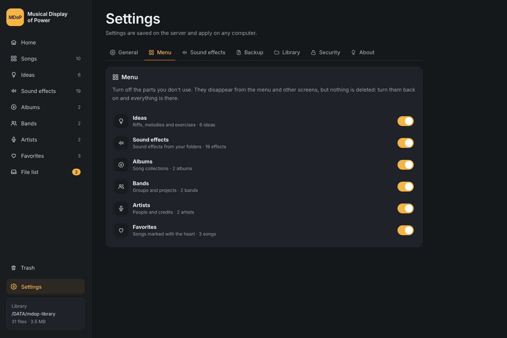

Settings are split into tabs, and each tab has its own address (for example `#/settings/backup`), so you can bookmark it.

- **General:** language (automatic follows the browser, or Portuguese or English), theme (dark, light or **Glass**) and accent color (yellow, blue, green, red or purple). Glass shows a blurred cover behind translucent panels: the open page's cover, or the playing song's cover, or an image you choose.
- **Menu:** turn off the parts you don't use: Ideas, Sound effects, Albums, Bands, Artists and Favorites. They disappear from the menu and from the other screens (buttons, home rows, search results, card circles), but **nothing is deleted**: turn them back on and everything is there.
- **Sound effects:** linked folders, rescan, and bringing back hidden effects.
- **Backup:** create, download, upload and restore backups (see below).
- **Library:** where it is on the server, how much space it uses and how much is free, the import folders, and the **automatic trash cleanup** (off by default).
- **Security:** create a username and password (optional), change the password, log out or remove the protection. After 5 wrong passwords, that device waits 5 minutes before trying again.
- **About:** version and project page.

Settings are stored on the server and apply to every computer and phone. View modes, tab and MIDI volume are remembered per browser.

## 15. Backup, updates and moving the library

**Backup.** In **Settings → Backup**:

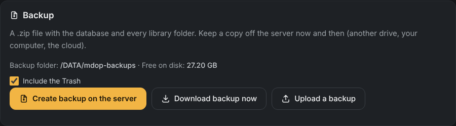

- **Create backup on the server** saves a `.zip` with the database and every library folder in the **backup folder** chosen during installation (ideally another drive). You can keep working while it's created.
- **Download backup now** sends the same `.zip` straight to your computer. Good for small libraries or for a copy off the server.
- **Include the Trash** is on by default; turn it off for a smaller backup.
- The `.zip` is not compressed again (audio is already compressed), so it's fast and about the size of the library.

**Restore.** Next to each saved backup there's **Restore**. MDoP first saves a **safety copy** of the current library (`before-restore-….zip`), then replaces the library with the backup's. A waiting screen covers the app until it finishes. Backups from older MDoP versions are upgraded on the fly. To restore a backup you have on your computer, use **Upload a backup** first; it then shows up in the list.

The library is also just folders, so copying the library folder by hand still works as a backup.

**Updates.** In the MDoP folder:

```bash
git pull
./install.sh         # answer "n" to keep your settings
```

The installer downloads the ready-made image (or builds it if it can't), and the database upgrades itself on start. Updates never change your music files.

**Coming from an early build** (folders named `musicas`, `ideias`, `.lixeira`…)? On the first start, MDoP renames the library folders to English names (`songs`, `ideas`, `.trash`…) while a waiting screen is shown. Before that it saves a copy of the database in `.mdop/` and, if there's room, a full backup (`before-update-….zip`) in the backup folder. Nothing is deleted, every file is checked afterwards, and if anything doesn't match, every change is undone and the library stays exactly as it was. Your old `.env` and `./instalar.sh` keep working too.

**Moving the library** to another disk:

```bash
./install.sh move
```

It copies, verifies the file count and size, switches, and keeps the old folder until you delete it.

## 16. Troubleshooting

**The page doesn't open.** Check that the container is running with `sudo docker ps` (look for `mdop`), and that you're using the right IP and port. Logs: `sudo docker logs mdop`.

**"Permission denied" when installing or importing.** The library folder must belong to the user in `.env` (`PUID`/`PGID`). Run `./install.sh` again, or `sudo chown -R $(id -u):$(id -g) /path/to/library`. If you extracted a release with `sudo tar`, fix the ownership of the MDoP folder the same way.

**I don't see my files under "From the server".** Only the import folder chosen during installation (`MDOP_IMPORT` in `.env`) is visible. Change it in `.env` or run `./install.sh` again and answer "y".

**An audio file shows "download only".** The browser can't play that format (common with `.amr`, `.wma` and some `.aif`). Convert it to mp3, m4a or wav.

**Sound effects says no folder is available.** No effects folder was given to MDoP. Run `./install.sh`, answer "y" to redo the questions, and enter the root folder of your effects.

**"The backup folder is not writable".** The backup folder must belong to the user in `.env` (`PUID`/`PGID`). Run `./install.sh` again (it fixes the owner), or choose another folder.

**After an update the page looks broken.** Force-reload with **Ctrl+Shift+R** (Cmd+Shift+R on a Mac).

**"Too many attempts".** After 5 wrong passwords, MDoP waits 5 minutes before accepting that device again.

**Forgot the password.**

```bash
sudo docker exec mdop python -m app disable-password
```

**Something else?** Open an issue on GitHub and describe what you did, what you expected and what happened.
